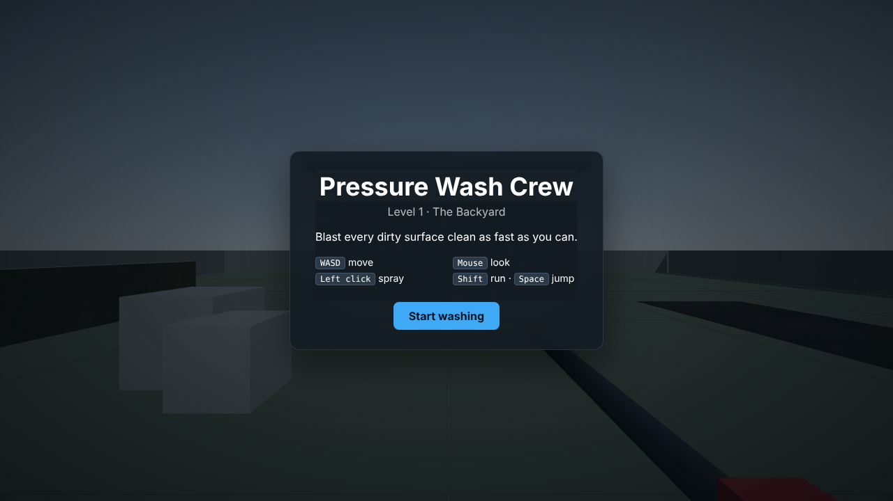
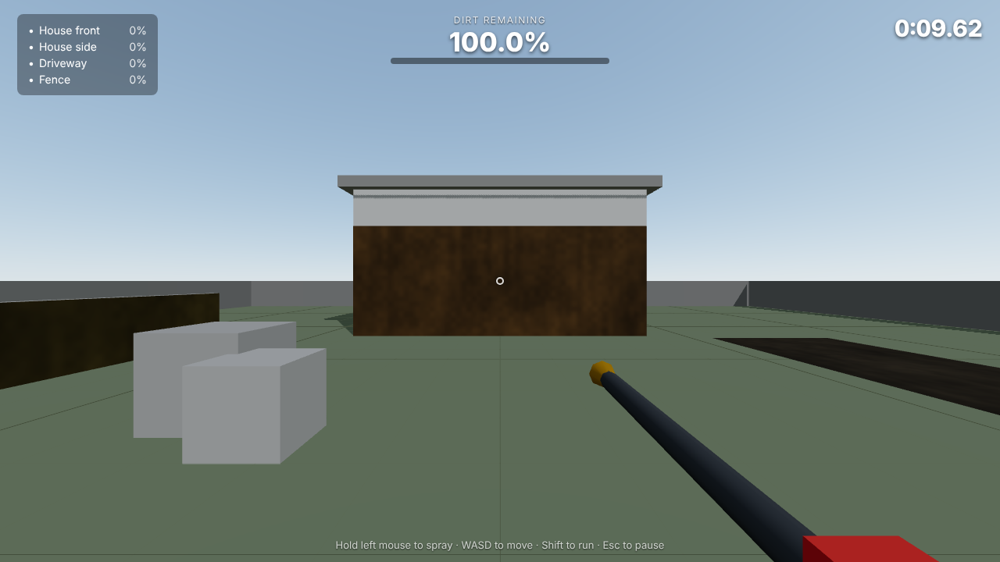
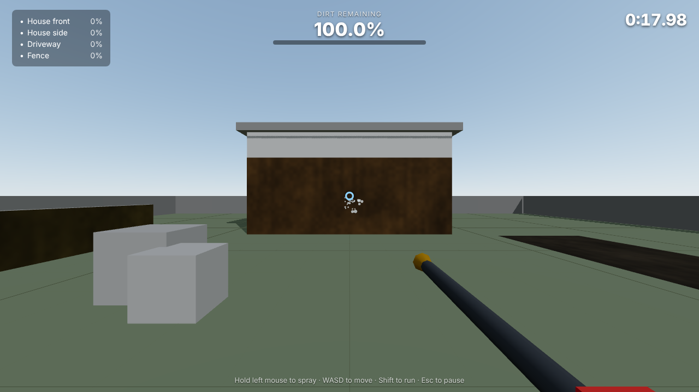
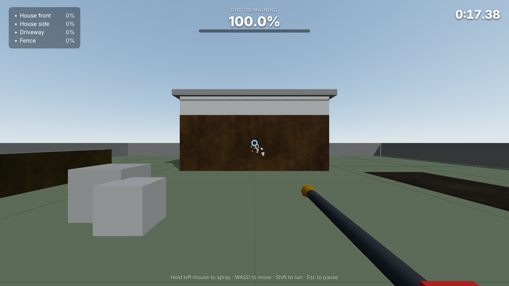
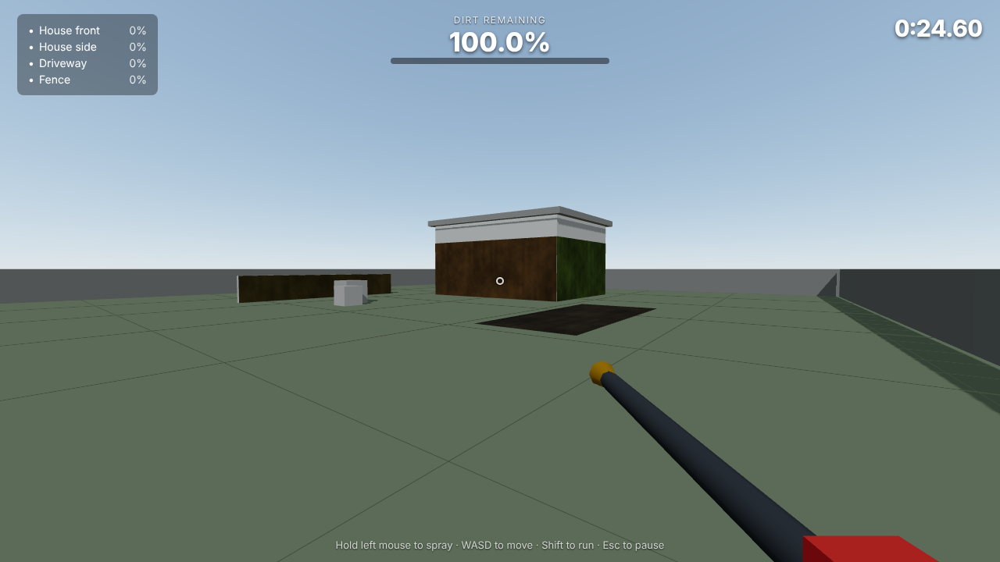
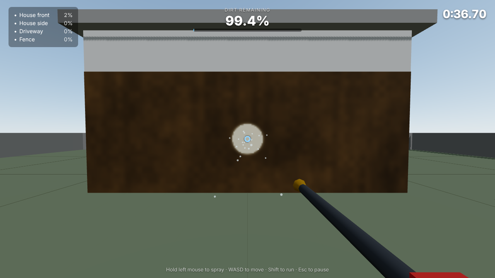
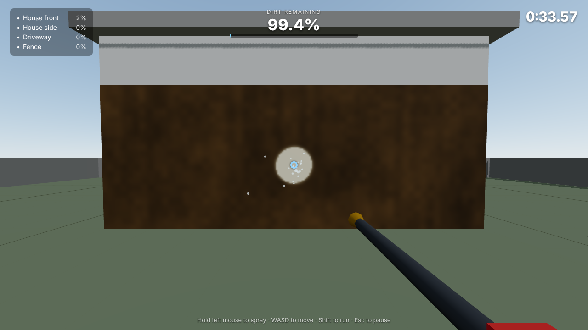
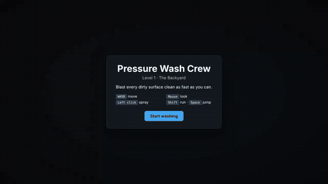

## Screenshots

| View | Before | After |
| --- | --- | --- |
| `menu` |  |  |
| `spawn` |  |  |
| `spawn-spraying` |  |  |
| `yard-overview` |  |  |
| `house-closeup-spraying` |  |  |

## Video walkthrough

Full video (after): [walkthrough.mp4](./after/walkthrough.mp4)

## Metrics

Target: **120 FPS = 8.33 ms/frame**. Frame time is the interval between frames with vsync off (real throughput); CPU is time spent in requestAnimationFrame callbacks (game logic + three.js draw submission); draw calls and triangles cover every pass, including the shadow map.

- Renderer: `ANGLE (Google, Vulkan 1.3.0 (SwiftShader Device (Subzero) (0x0000C0DE)), SwiftShader driver)` (headless), 1280×720, 4s sample per view
- Before: `d879b16` · After: `d879b16 + uncommitted changes`
- ⚠️ **Software GPU** (SwiftShader). Absolute FPS here is far below real hardware, so the 120 FPS column only checks CPU time per frame; judge by the before → after deltas, and re-run with `--headed` on a machine with a GPU for absolute numbers.

| View | Frame ms median (before → after) | Frame ms p95 | FPS | CPU ms median | Draw calls | Triangles | 120 FPS |
| --- | --- | --- | --- | --- | --- | --- | --- |
| `menu` | 111.60 → 98.60 (-11.6%) | 136.60 → 116.70 (-14.6%) | 9.0 → 10.0 (+11.6%) | 1.30 → 1.10 (-15.4%) | 29 → 29 (+0.0%) | 25,516 → 25,516 (+0.0%) | GPU n/a · CPU ✅ |
| `spawn` | 107.90 → 99.80 (-7.5%) | 127.70 → 118.90 (-6.9%) | 9.3 → 9.8 (+5.8%) | 1.10 → 1.00 (-9.1%) | 29 → 29 (+0.0%) | 25,516 → 25,516 (+0.0%) | GPU n/a · CPU ✅ |
| `spawn-spraying` | 99.00 → 99.90 (+0.9%) | 117.50 → 119.40 (+1.6%) | 9.9 → 10.0 (+0.1%) | 1.10 → 1.20 (+9.1%) | 29 → 29 (+0.0%) | 25,516 → 25,516 (+0.0%) | GPU n/a · CPU ✅ |
| `yard-overview` | 105.70 → 79.70 (-24.6%) | 118.90 → 99.10 (-16.7%) | 9.5 → 12.3 (+29.7%) | 1.00 → 1.00 (+0.0%) | 29 → 29 (+0.0%) | 25,516 → 25,516 (+0.0%) | GPU n/a · CPU ✅ |
| `house-closeup-spraying` | 118.70 → 114.80 (-3.3%) | 137.90 → 128.40 (-6.9%) | 8.3 → 8.9 (+7.0%) | 1.10 → 1.10 (+0.0%) | 25 → 25 (+0.0%) | 25,478 → 25,478 (+0.0%) | GPU n/a · CPU ✅ |

Thresholds for the suggested risk: frame time +25% / triangles or draw calls +25% ⇒ High; +10% / +5% ⇒ Medium. Frame-time bands are wider on a software GPU (±10% run-to-run noise is normal there).

<!-- suggested-risk: Low -->
