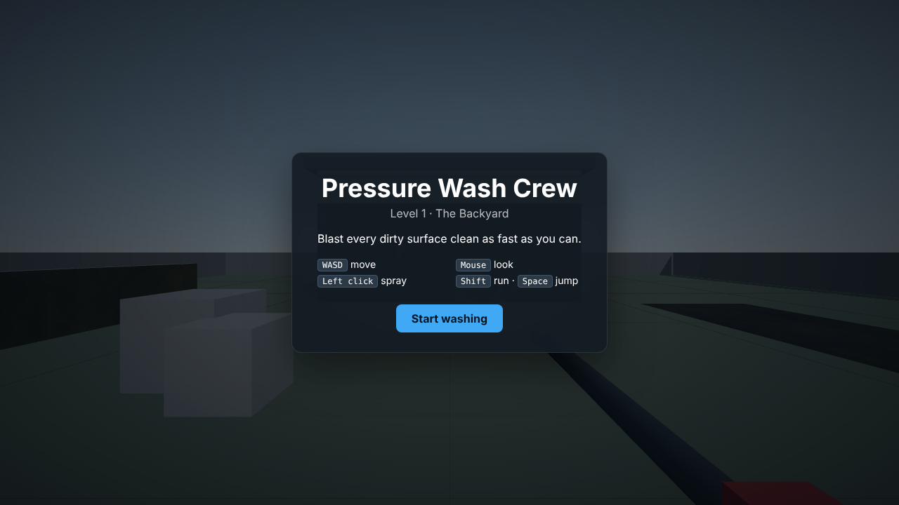
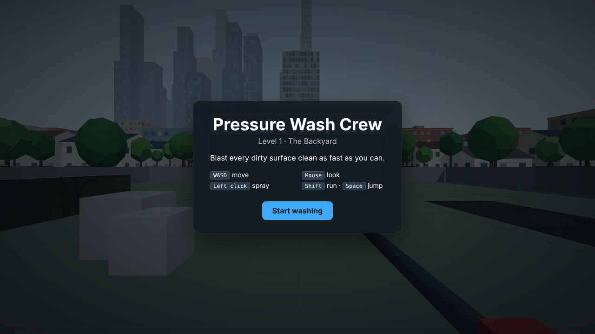
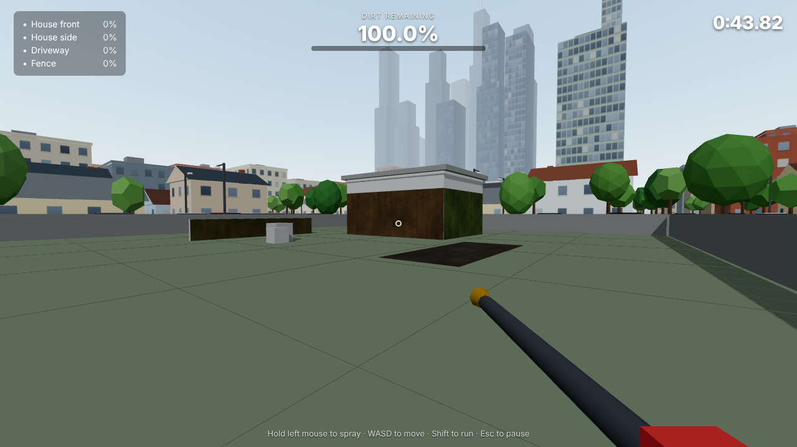
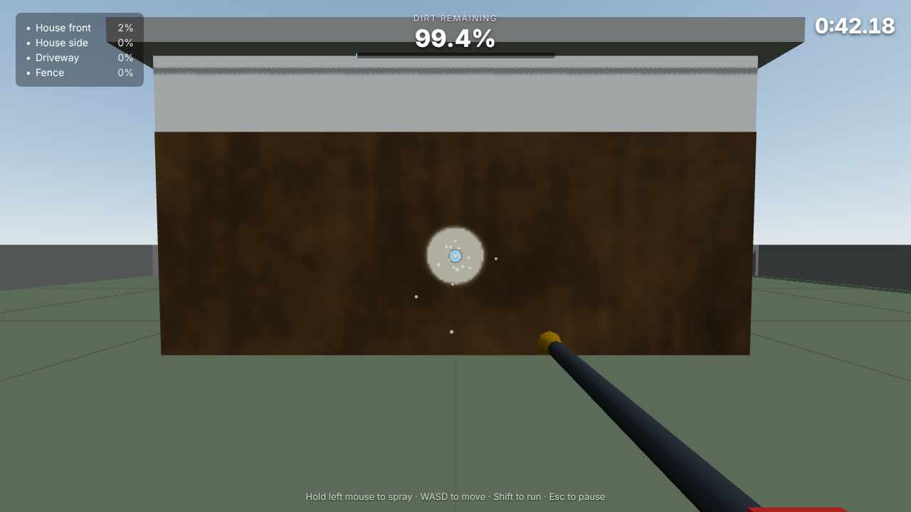
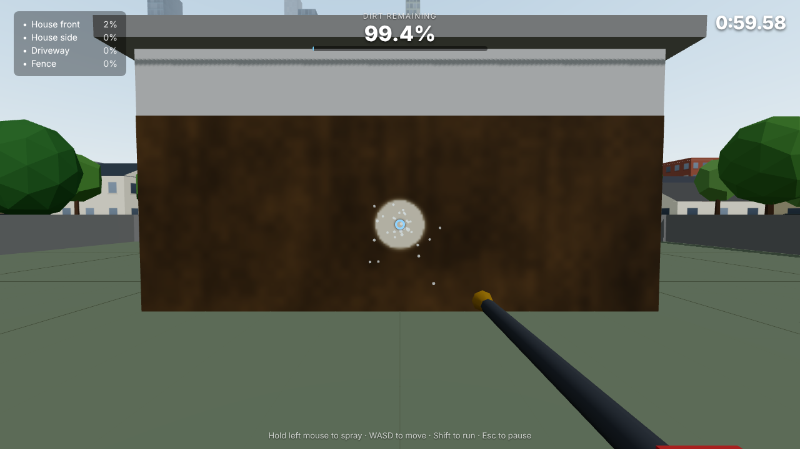
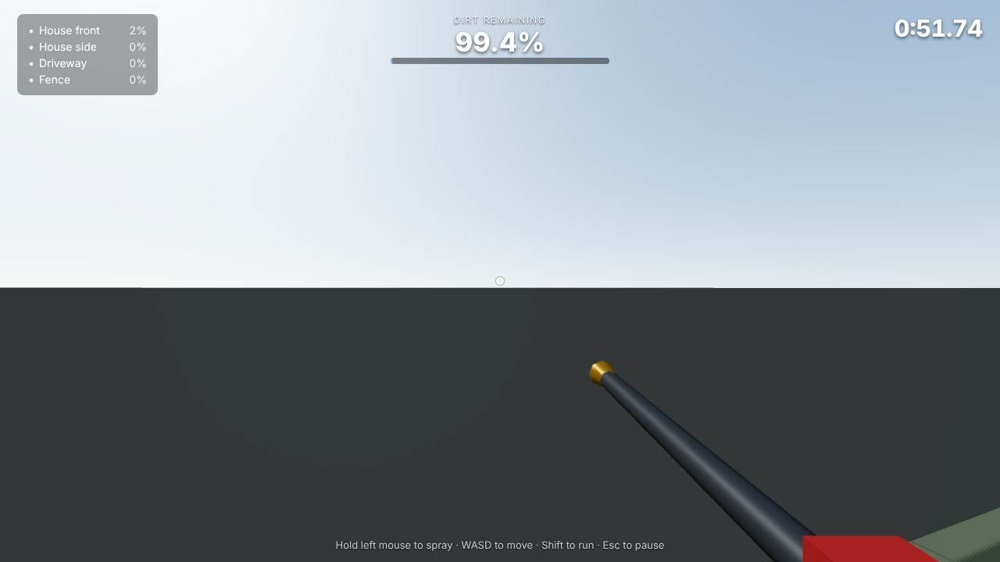
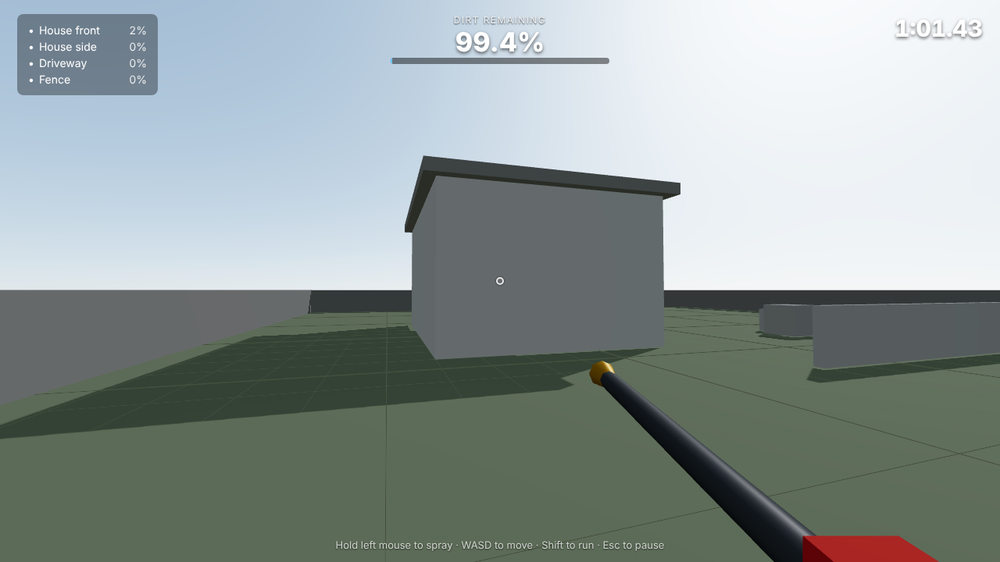
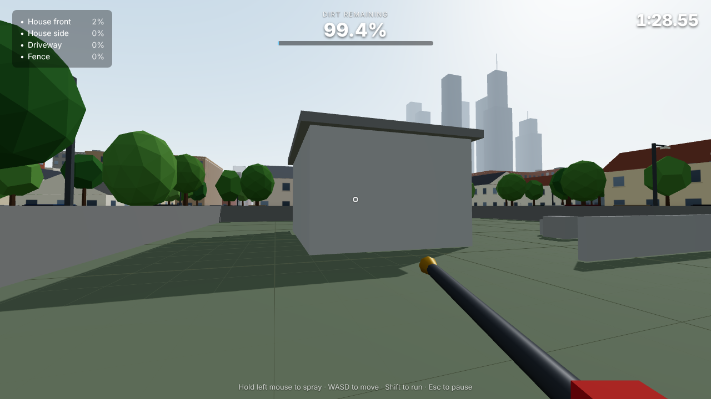
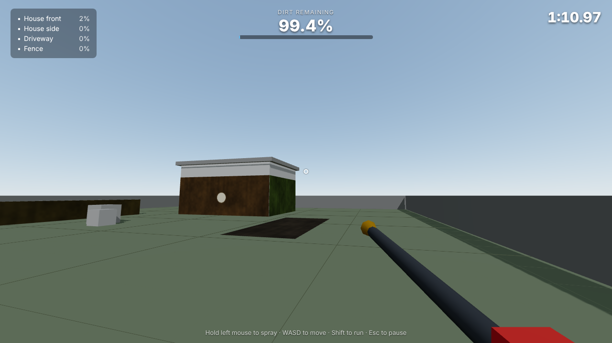
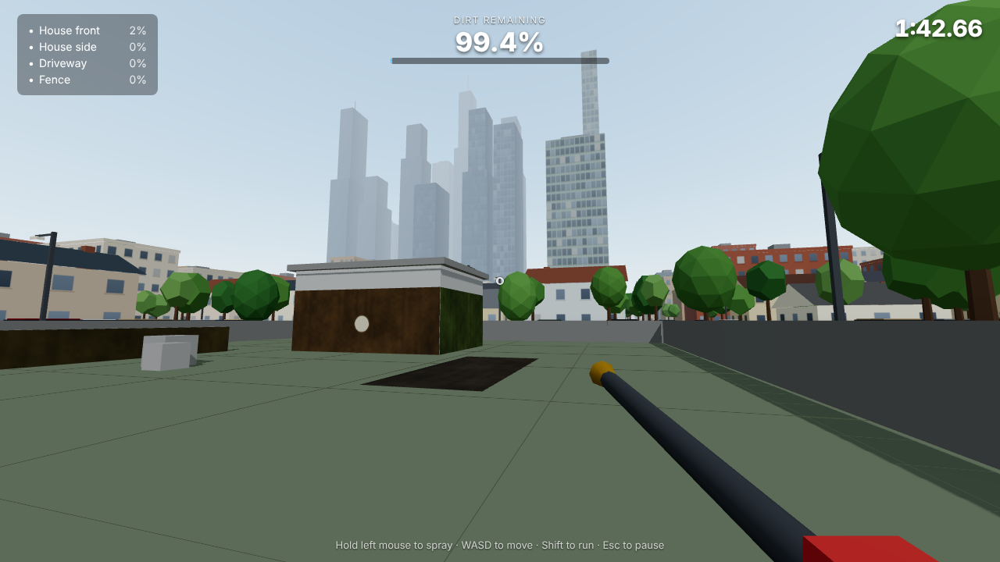

## Screenshots

| View | Before | After |
| --- | --- | --- |
| `menu` |  |  |
| `spawn` |  |  |
| `spawn-spraying` |  |  |
| `yard-overview` |  |  |
| `house-closeup-spraying` |  |  |
| `city-street-front` |  |  |
| `city-neighbors-east` |  |  |
| `city-skyline` |  |  |

## Video walkthrough

Full video (after): [walkthrough.mp4](./after/walkthrough.mp4)

## Metrics

Target: **120 FPS = 8.33 ms/frame**. Frame time is the interval between frames with vsync off (real throughput); CPU is time spent in requestAnimationFrame callbacks (game logic + three.js draw submission); draw calls and triangles cover every pass, including the shadow map.

- Renderer: `ANGLE (Google, Vulkan 1.3.0 (SwiftShader Device (Subzero) (0x0000C0DE)), SwiftShader driver)` (headless), 1280×720, 4s sample per view
- Before: `d879b16` · After: `d879b16 + uncommitted changes`
- ⚠️ **Software GPU** (SwiftShader). Absolute FPS here is far below real hardware, so the 120 FPS column only checks CPU time per frame; judge by the before → after deltas, and re-run with `--headed` on a machine with a GPU for absolute numbers.

| View | Frame ms median (before → after) | Frame ms p95 | FPS | CPU ms median | Draw calls | Triangles | 120 FPS |
| --- | --- | --- | --- | --- | --- | --- | --- |
| `menu` | 123.60 → 196.60 (+59.1%) | 142.40 → 226.90 (+59.3%) | 8.2 → 5.1 (-37.6%) | 1.30 → 1.70 (+30.8%) | 29 → 37 (+27.6%) | 25,516 → 49,284 (+93.1%) | GPU n/a · CPU ✅ |
| `spawn` | 126.20 → 202.40 (+60.4%) | 143.90 → 237.80 (+65.3%) | 8.0 → 4.9 (-38.3%) | 1.30 → 1.50 (+15.4%) | 29 → 37 (+27.6%) | 25,516 → 49,284 (+93.1%) | GPU n/a · CPU ✅ |
| `spawn-spraying` | 130.40 → 174.20 (+33.6%) | 153.00 → 203.60 (+33.1%) | 7.6 → 5.7 (-25.3%) | 1.50 → 1.40 (-6.7%) | 29 → 37 (+27.6%) | 25,516 → 49,284 (+93.1%) | GPU n/a · CPU ✅ |
| `yard-overview` | 111.90 → 178.30 (+59.3%) | 131.90 → 208.40 (+58.0%) | 9.2 → 5.6 (-38.9%) | 1.20 → 1.20 (+0.0%) | 29 → 36 (+24.1%) | 25,516 → 47,784 (+87.3%) | GPU n/a · CPU ✅ |
| `house-closeup-spraying` | 149.50 → 209.80 (+40.3%) | 169.80 → 246.90 (+45.4%) | 6.7 → 4.7 (-29.2%) | 1.40 → 1.60 (+14.3%) | 25 → 33 (+32.0%) | 25,478 → 49,246 (+93.3%) | GPU n/a · CPU ✅ |
| `city-street-front` | 107.90 → 192.40 (+78.3%) | 122.90 → 223.30 (+81.7%) | 9.4 → 5.2 (-44.4%) | 1.00 → 1.10 (+10.0%) | 17 → 24 (+41.2%) | 25,412 → 47,410 (+86.6%) | GPU n/a · CPU ✅ |
| `city-neighbors-east` | 121.90 → 180.40 (+48.0%) | 139.80 → 205.30 (+46.9%) | 8.1 → 5.5 (-32.3%) | 1.10 → 1.20 (+9.1%) | 29 → 37 (+27.6%) | 25,516 → 49,034 (+92.2%) | GPU n/a · CPU ✅ |
| `city-skyline` | 117.00 → 185.10 (+58.2%) | 133.00 → 214.40 (+61.2%) | 8.6 → 5.4 (-37.5%) | 1.10 → 1.20 (+9.1%) | 29 → 37 (+27.6%) | 25,516 → 49,284 (+93.1%) | GPU n/a · CPU ✅ |

Thresholds for the suggested risk: frame time +25% / triangles or draw calls +25% ⇒ High; +10% / +5% ⇒ Medium. Frame-time bands are wider on a software GPU (±10% run-to-run noise is normal there).

<!-- suggested-risk: High (`menu` frame time +59.1%; `menu` triangles +93.1%; `menu` draw calls +27.6%; `spawn` frame time +60.4%; `spawn` triangles +93.1%; `spawn` draw calls +27.6%; `spawn-spraying` frame time +33.6%; `spawn-spraying` triangles +93.1%; `spawn-spraying` draw calls +27.6%; `yard-overview` frame time +59.3%; `yard-overview` triangles +87.3%; `yard-overview` draw calls +24.1%; `house-closeup-spraying` frame time +40.3%; `house-closeup-spraying` triangles +93.3%; `house-closeup-spraying` draw calls +32.0%; `city-street-front` frame time +78.3%; `city-street-front` triangles +86.6%; `city-street-front` draw calls +41.2%; `city-neighbors-east` frame time +48.0%; `city-neighbors-east` triangles +92.2%; `city-neighbors-east` draw calls +27.6%; `city-skyline` frame time +58.2%; `city-skyline` triangles +93.1%; `city-skyline` draw calls +27.6%) -->
