## Screenshots

| View | Before | After |
| --- | --- | --- |
| `menu` |  | 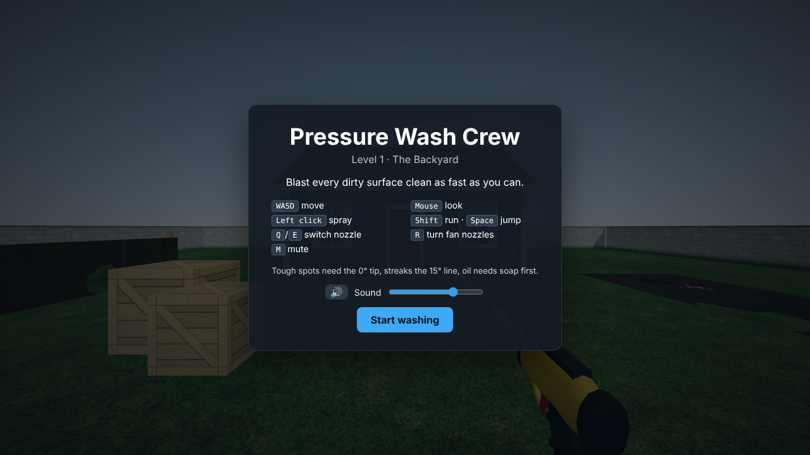 |
| `spawn` | 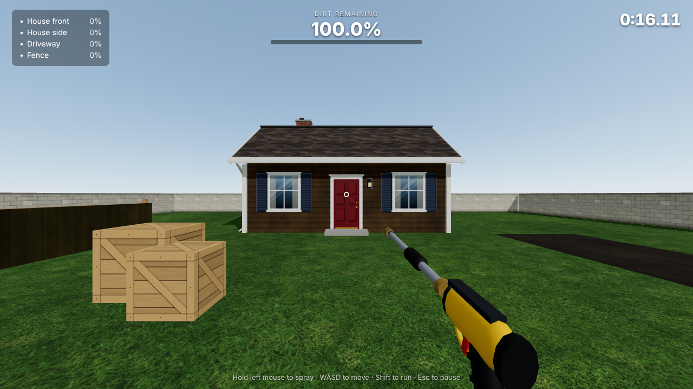 |  |
| `spawn-spraying` |  |  |
| `yard-overview` | 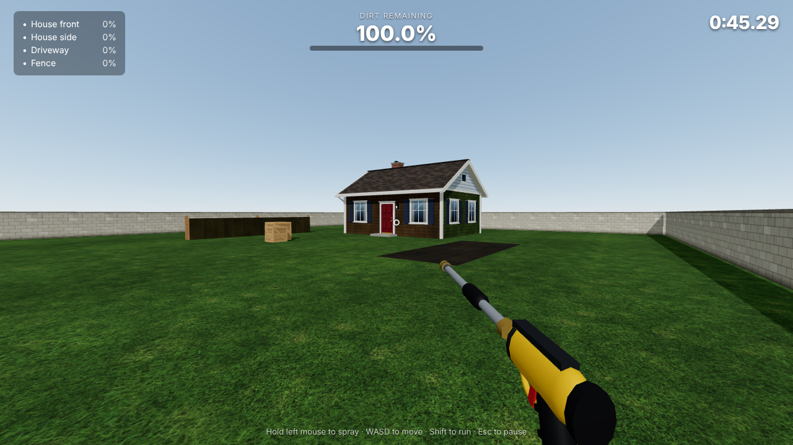 |  |
| `house-closeup-spraying` | 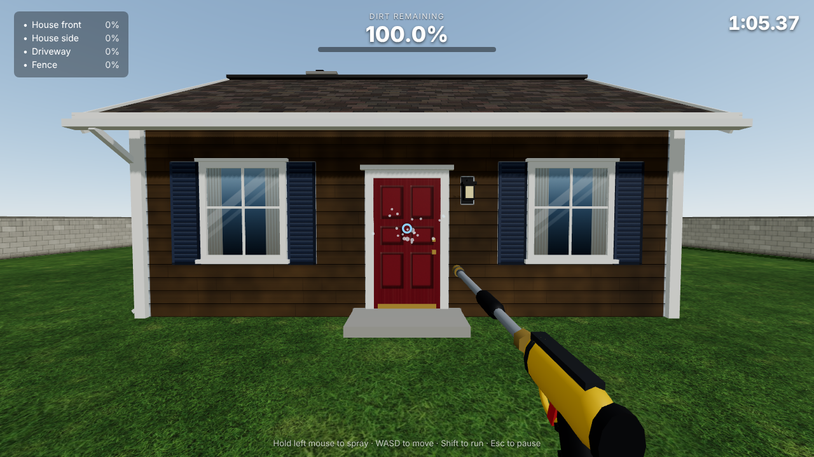 | 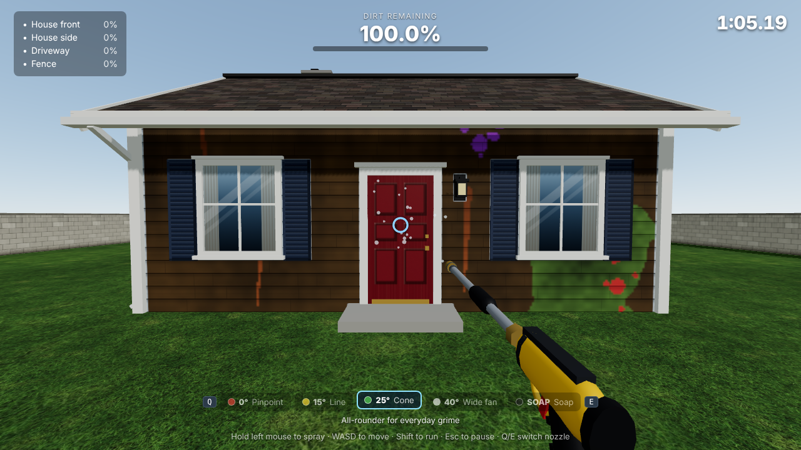 |
| `driveway-spraying` | 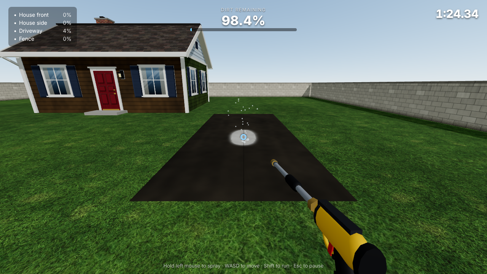 | 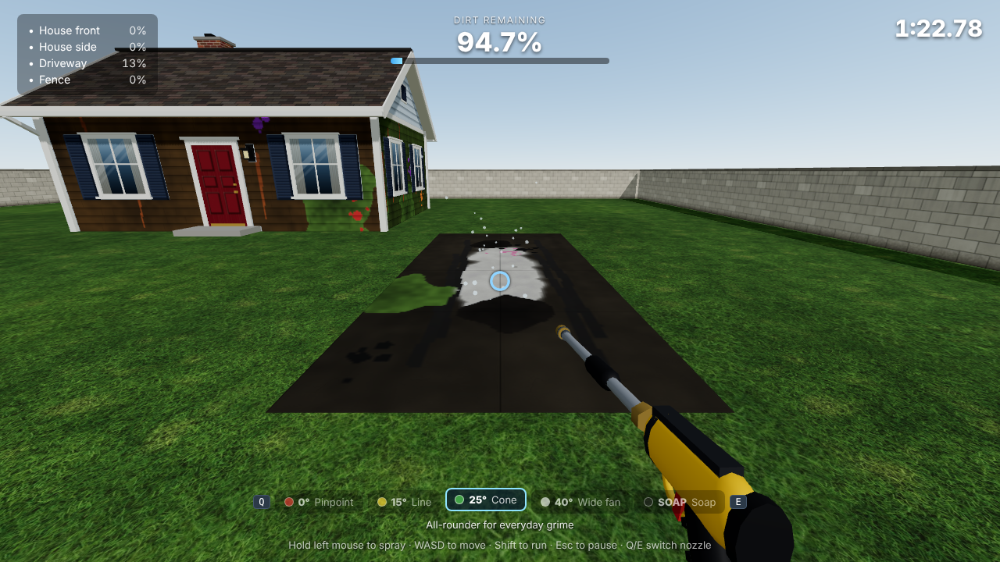 |
| `fence-closeup` | 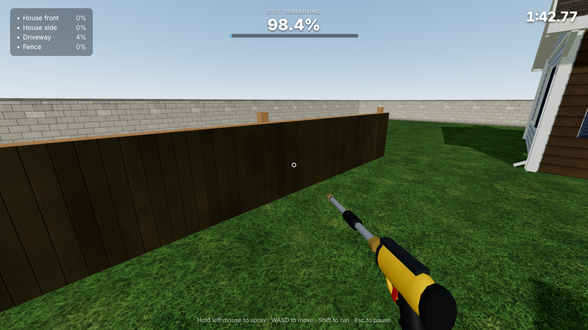 | 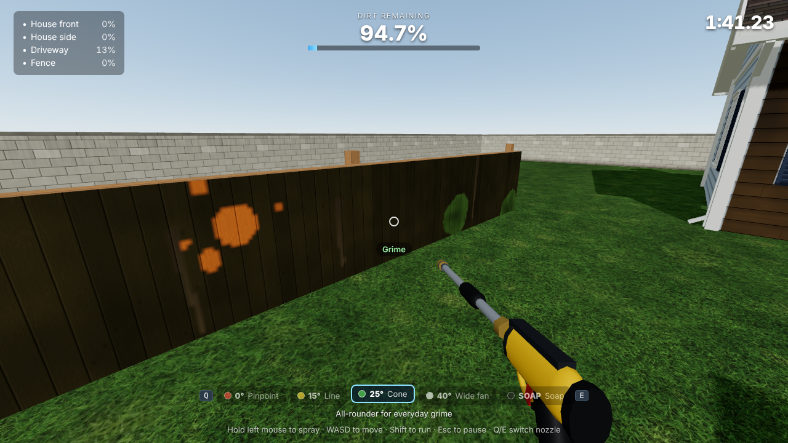 |
| `perimeter-wall` | 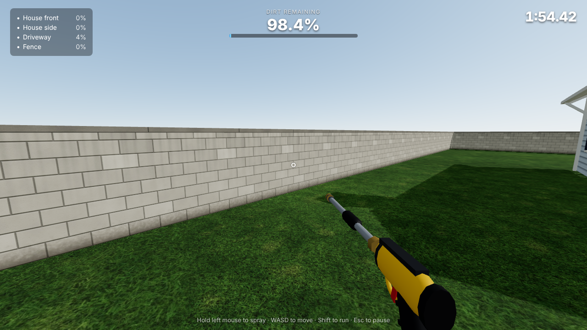 | 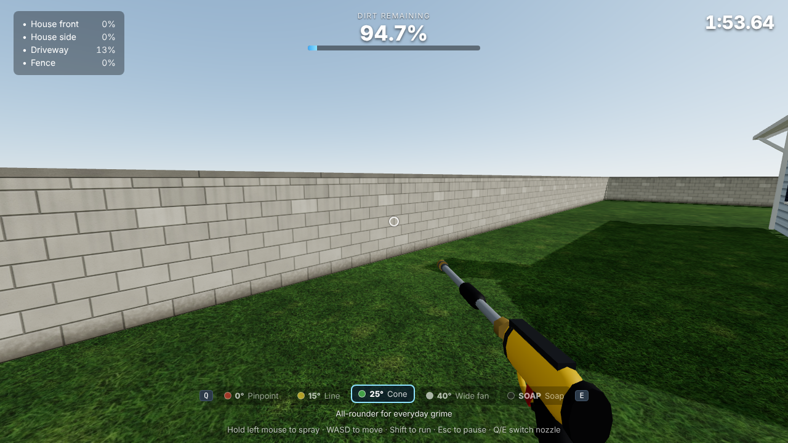 |
| `house-corner` | 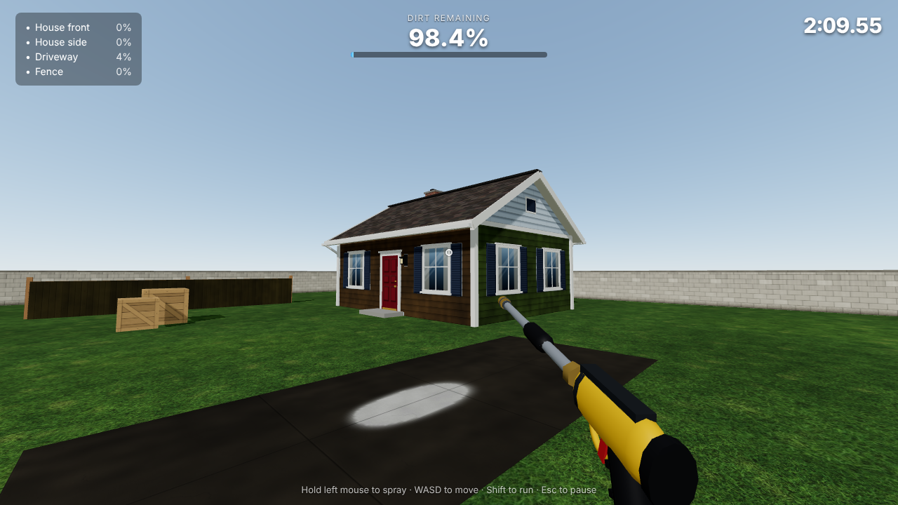 | 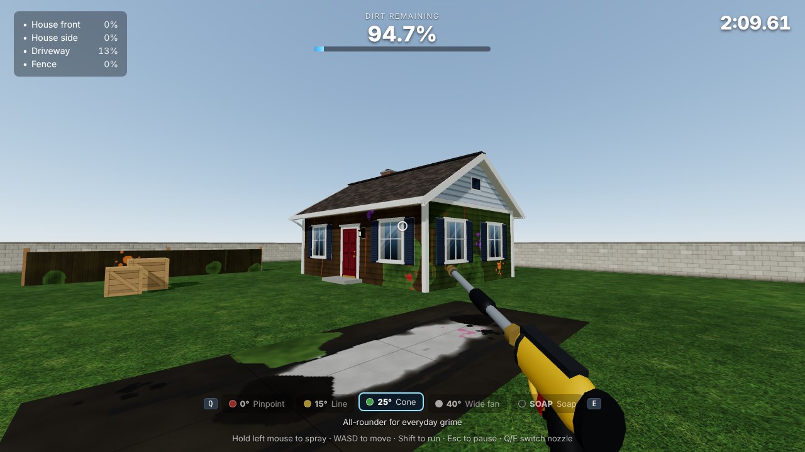 |
| `house-door-spraying` | 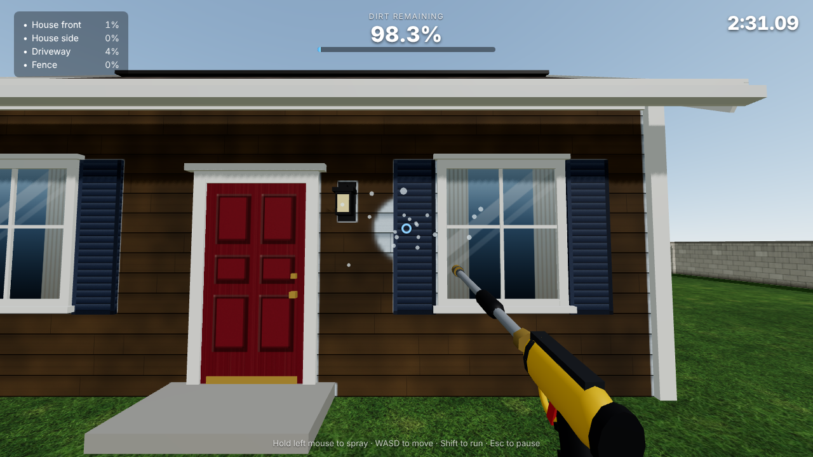 | 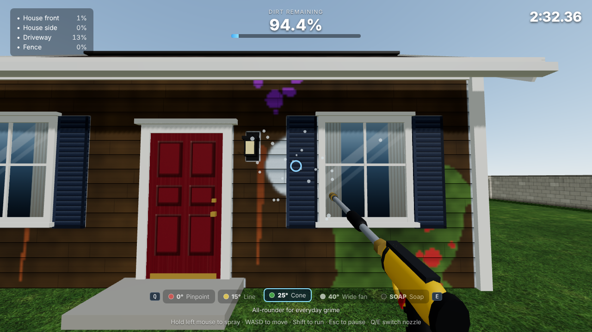 |
| `house-stains` |  |  |
| `driveway-stains` |  |  |
| `wall-celebration` | 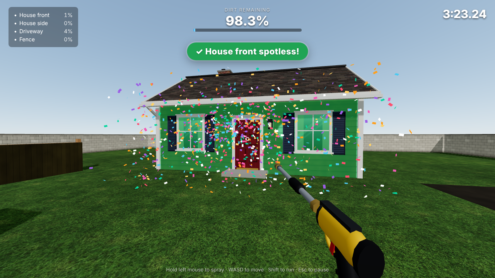 |  |

## Video walkthrough

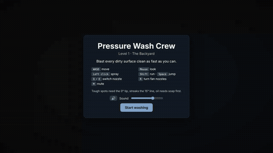
Full video (after): [walkthrough.mp4](./after/walkthrough.mp4)

## Metrics

Target: **120 FPS = 8.33 ms/frame**. Frame time is the interval between frames with vsync off (real throughput); CPU is time spent in requestAnimationFrame callbacks (game logic + three.js draw submission); draw calls and triangles cover every pass, including the shadow map.

- Renderer: `ANGLE (Google, Vulkan 1.3.0 (SwiftShader Device (Subzero) (0x0000C0DE)), SwiftShader driver)` (headless), playwright chromium 158.0.8127.36, 1280×720, 4s × 1 sample(s) per view
- Before: `152a43f` · After: `c44f97f`
- ⚠️ **Software GPU** (SwiftShader). Absolute FPS here is far below real hardware, so the 120 FPS column only checks CPU time per frame; judge by the before → after deltas, and re-run with `--headed` on a machine with a GPU for absolute numbers.

| View | Frame ms median (before → after) | Frame ms p95 | FPS | CPU ms median | Draw calls | Triangles | 120 FPS |
| --- | --- | --- | --- | --- | --- | --- | --- |
| `menu` | 203.90 → 193.10 (-5.3%) | 227.90 → 227.40 (-0.2%) | 4.9 → 5.1 (+3.9%) | 2.20 → 1.50 (-31.8%) | 30 → 30 (+0.0%) | 29,572 → 29,572 (+0.0%) | GPU n/a · CPU ✅ |
| `spawn` | 198.70 → 202.30 (+1.8%) | 225.10 → 228.50 (+1.5%) | 5.0 → 4.9 (-1.4%) | 1.50 → 1.60 (+6.7%) | 30 → 30 (+0.0%) | 29,572 → 29,572 (+0.0%) | GPU n/a · CPU ✅ |
| `spawn-spraying` | 189.10 → 196.10 (+3.7%) | 208.10 → 221.90 (+6.6%) | 5.3 → 5.1 (-3.0%) | 1.60 → 1.60 (-0.0%) | 30 → 30 (+0.0%) | 29,572 → 29,572 (+0.0%) | GPU n/a · CPU ✅ |
| `yard-overview` | 184.30 → 190.90 (+3.6%) | 215.40 → 214.60 (-0.4%) | 5.4 → 5.2 (-2.5%) | 1.40 → 1.40 (+0.0%) | 30 → 30 (+0.0%) | 29,572 → 29,572 (+0.0%) | GPU n/a · CPU ✅ |
| `house-closeup-spraying` | 260.80 → 254.50 (-2.4%) | 313.50 → 291.90 (-6.9%) | 3.8 → 3.9 (+3.7%) | 1.70 → 1.70 (+0.0%) | 27 → 27 (+0.0%) | 29,474 → 29,474 (+0.0%) | GPU n/a · CPU ✅ |
| `driveway-spraying` | 237.00 → 218.50 (-7.8%) | 273.40 → 257.50 (-5.8%) | 4.2 → 4.5 (+7.7%) | 1.70 → 1.70 (+0.0%) | 27 → 27 (+0.0%) | 29,474 → 29,474 (+0.0%) | GPU n/a · CPU ✅ |
| `fence-closeup` | 237.90 → 237.40 (-0.2%) | 282.10 → 270.60 (-4.1%) | 4.2 → 4.2 (+0.3%) | 1.30 → 1.50 (+15.4%) | 25 → 25 (+0.0%) | 29,520 → 29,520 (+0.0%) | GPU n/a · CPU ✅ |
| `perimeter-wall` | 143.40 → 146.10 (+1.9%) | 160.20 → 173.50 (+8.3%) | 7.0 → 6.9 (-2.0%) | 1.20 → 1.20 (-0.0%) | 23 → 23 (+0.0%) | 29,446 → 29,446 (+0.0%) | GPU n/a · CPU ✅ |
| `house-corner` | 193.20 → 209.40 (+8.4%) | 250.50 → 242.60 (-3.2%) | 5.0 → 4.7 (-5.4%) | 1.30 → 1.30 (+0.0%) | 30 → 30 (+0.0%) | 29,572 → 29,572 (+0.0%) | GPU n/a · CPU ✅ |
| `house-door-spraying` | 292.80 → 302.50 (+3.3%) | 327.20 → 345.70 (+5.7%) | 3.4 → 3.3 (-3.8%) | 1.60 → 1.60 (+0.0%) | 26 → 26 (+0.0%) | 29,472 → 29,472 (+0.0%) | GPU n/a · CPU ✅ |
| `house-stains` | 205.60 → 231.40 (+12.5%) | 240.00 → 293.30 (+22.2%) | 4.8 → 4.2 (-12.4%) | 1.30 → 1.50 (+15.4%) | 29 → 29 (+0.0%) | 29,548 → 29,548 (+0.0%) | GPU n/a · CPU ✅ |
| `driveway-stains` | 217.80 → 242.60 (+11.4%) | 253.00 → 289.60 (+14.5%) | 4.6 → 4.1 (-11.0%) | 1.30 → 1.70 (+30.8%) | 29 → 29 (+0.0%) | 29,548 → 29,548 (+0.0%) | GPU n/a · CPU ✅ |
| `wall-celebration` | 246.40 → 259.00 (+5.1%) | 279.70 → 293.80 (+5.0%) | 4.0 → 3.8 (-5.4%) | 1.50 → 1.70 (+13.3%) | 34 → 34 (+0.0%) | 31,578 → 31,578 (+0.0%) | GPU n/a · CPU ✅ |

Suggested-risk thresholds: triangles or draw calls +25% ⇒ High, +5% ⇒ Medium. Frame time (software GPU, ±10% noise is normal): +25% ⇒ High, +10% ⇒ Medium.

### Against the main baseline

- Baseline: `d879b16` recorded 2026-11-24 on MacBook Pro (Mac15,6), Apple M3 Pro: `ANGLE (Apple, ANGLE Metal Renderer: Apple M3 Pro, Unspecified Version)` (headed), chrome 158.0.8127.37, 1280×720, 3 runs × 3 samples, vsync off.
- This capture ran on `ANGLE (Google, Vulkan 1.3.0 (SwiftShader Device (Subzero) (0x0000C0DE)), SwiftShader driver)` (headless), playwright chromium 158.0.8127.36, 1280×720, not the baseline's setup, so only draw calls and triangles (which don't depend on the machine) are compared. For frame time against the baseline, run `pnpm pr:capture --headed --channel chrome` on the baseline machine.
- main has moved since the baseline (`d879b16` → `152a43f`). A regression that **Before** also shows came from main, not this PR, and only counts as main drift.

| View | FPS (baseline → after) | Frame ms mean | Frame ms p95 | CPU ms mean | Draw calls | Triangles | vs baseline |
| --- | --- | --- | --- | --- | --- | --- | --- |
| `menu` | _n/a_ | _n/a_ | _n/a_ | _n/a_ | 29 → 30 (+3.4%) | 25,516 → 29,572 (+15.9%) | ↔️ main drift: triangles +15.9% |
| `spawn` | _n/a_ | _n/a_ | _n/a_ | _n/a_ | 29 → 30 (+3.4%) | 25,516 → 29,572 (+15.9%) | ↔️ main drift: triangles +15.9% |
| `spawn-spraying` | _n/a_ | _n/a_ | _n/a_ | _n/a_ | 29 → 30 (+3.4%) | 25,516 → 29,572 (+15.9%) | ↔️ main drift: triangles +15.9% |
| `yard-overview` | _n/a_ | _n/a_ | _n/a_ | _n/a_ | 29 → 30 (+3.4%) | 25,516 → 29,572 (+15.9%) | ↔️ main drift: triangles +15.9% |
| `house-closeup-spraying` | _n/a_ | _n/a_ | _n/a_ | _n/a_ | 25 → 27 (+8.0%) | 25,478 → 29,474 (+15.7%) | ↔️ main drift: triangles +15.7%, draw calls +8.0% |
| `driveway-spraying` | _not in baseline_ | | | | | | 🆕 new view |
| `fence-closeup` | _not in baseline_ | | | | | | 🆕 new view |
| `perimeter-wall` | _not in baseline_ | | | | | | 🆕 new view |
| `house-corner` | _not in baseline_ | | | | | | 🆕 new view |
| `house-door-spraying` | _not in baseline_ | | | | | | 🆕 new view |
| `house-stains` | _not in baseline_ | | | | | | 🆕 new view |
| `driveway-stains` | _not in baseline_ | | | | | | 🆕 new view |
| `wall-celebration` | _not in baseline_ | | | | | | 🆕 new view |

↔️ `menu`, `spawn`, `spawn-spraying`, `yard-overview`, `house-closeup-spraying`: main (Before) is already this far from the baseline, so it doesn't count against this PR. If main got slower on purpose, refresh the baseline with `pnpm perf:baseline`; if not, it needs a look.

<!-- suggested-risk: Medium (`house-stains` frame time +29.63 ms (+14.2%); `driveway-stains` frame time +26.83 ms (+12.3%)) -->
