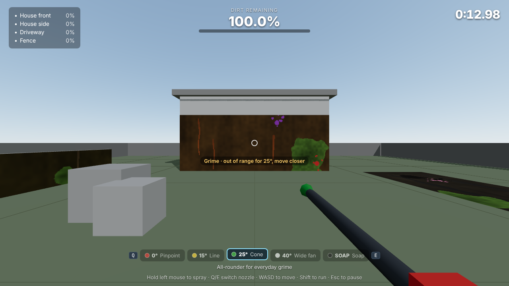
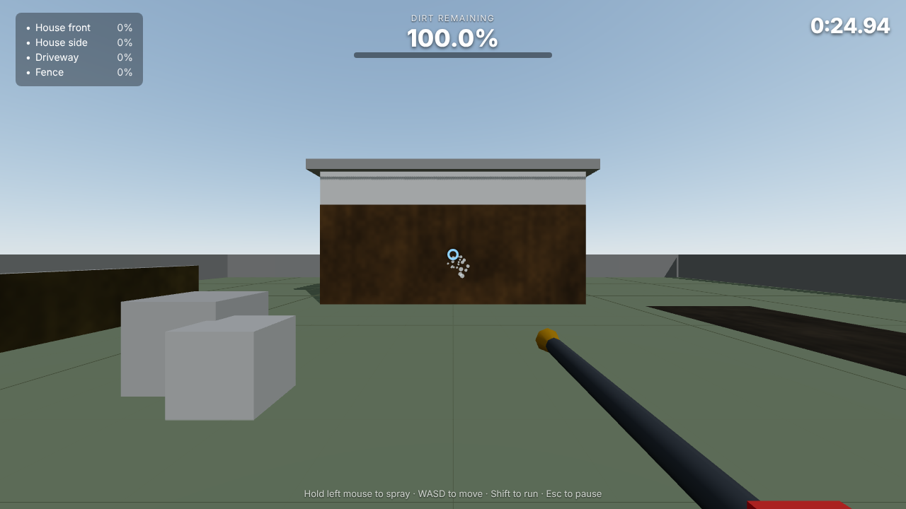
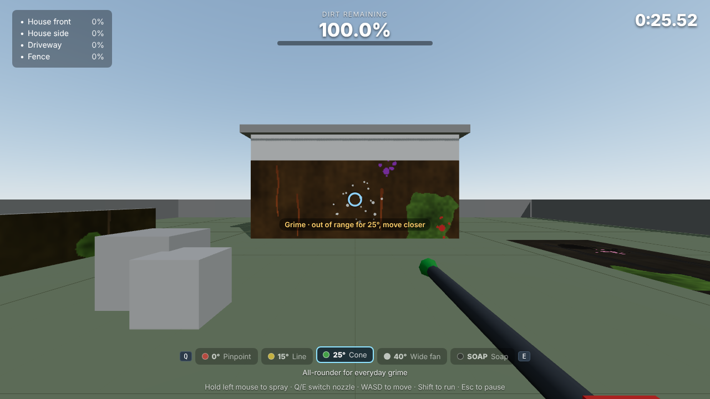
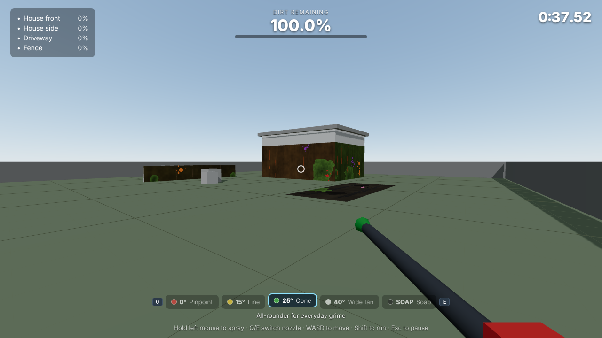
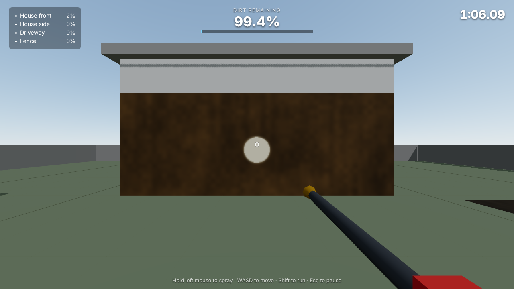
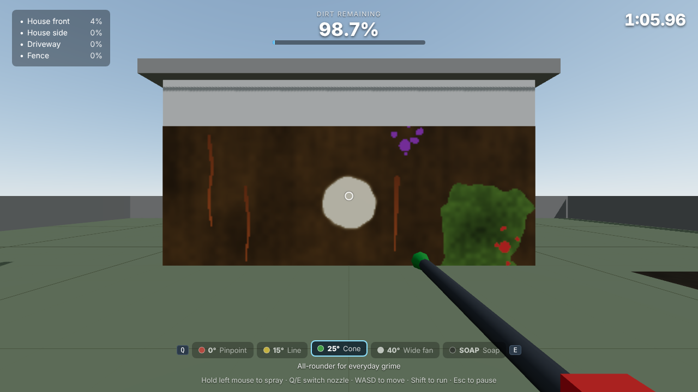
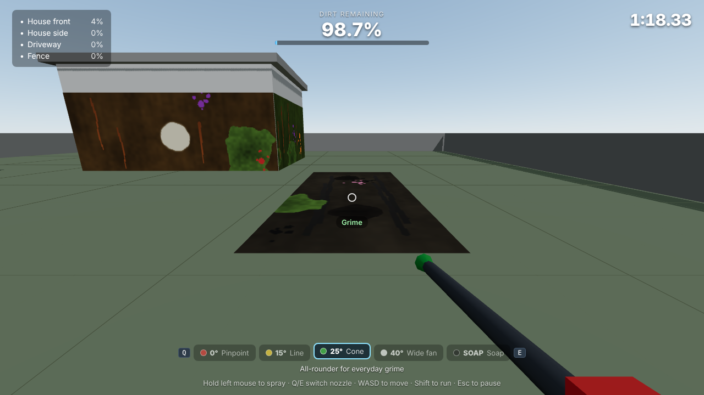

## Screenshots

| View | Before | After |
| --- | --- | --- |
| `menu` |  |  |
| `spawn` |  |  |
| `spawn-spraying` |  |  |
| `yard-overview` |  |  |
| `house-closeup-spraying` |  |  |
| `house-stains` |  |  |
| `driveway-stains` |  |  |

## Video walkthrough

Full video (after): [walkthrough.mp4](./after/walkthrough.mp4)

## Metrics

Target: **120 FPS = 8.33 ms/frame**. Frame time is the interval between frames with vsync off (real throughput); CPU is time spent in requestAnimationFrame callbacks (game logic + three.js draw submission); draw calls and triangles cover every pass, including the shadow map.

- Renderer: `ANGLE (Google, Vulkan 1.3.0 (SwiftShader Device (Subzero) (0x0000C0DE)), SwiftShader driver)` (headless), 1280×720, 4s sample per view
- Before: `d879b16` · After: `1cb4576`
- ⚠️ **Software GPU** (SwiftShader). Absolute FPS here is far below real hardware, so the 120 FPS column only checks CPU time per frame; judge by the before → after deltas, and re-run with `--headed` on a machine with a GPU for absolute numbers.

| View | Frame ms median (before → after) | Frame ms p95 | FPS | CPU ms median | Draw calls | Triangles | 120 FPS |
| --- | --- | --- | --- | --- | --- | --- | --- |
| `menu` | 155.30 → 169.60 (+9.2%) | 182.80 → 192.40 (+5.3%) | 6.5 → 5.9 (-9.2%) | 1.50 → 1.70 (+13.3%) | 29 → 29 (+0.0%) | 25,516 → 25,516 (+0.0%) | GPU n/a · CPU ✅ |
| `spawn` | 160.90 → 159.20 (-1.1%) | 182.10 → 176.50 (-3.1%) | 6.3 → 6.3 (-0.2%) | 1.30 → 1.70 (+30.8%) | 29 → 29 (+0.0%) | 25,516 → 25,516 (+0.0%) | GPU n/a · CPU ✅ |
| `spawn-spraying` | 158.50 → 156.20 (-1.5%) | 197.10 → 174.50 (-11.5%) | 6.2 → 6.4 (+2.0%) | 1.50 → 1.50 (+0.0%) | 29 → 29 (+0.0%) | 25,516 → 25,516 (+0.0%) | GPU n/a · CPU ✅ |
| `yard-overview` | 151.40 → 147.70 (-2.4%) | 173.40 → 174.90 (+0.9%) | 6.6 → 6.8 (+2.9%) | 1.30 → 1.30 (+0.0%) | 29 → 29 (+0.0%) | 25,516 → 25,516 (+0.0%) | GPU n/a · CPU ✅ |
| `house-closeup-spraying` | 188.30 → 194.40 (+3.2%) | 211.90 → 221.20 (+4.4%) | 5.4 → 5.2 (-2.5%) | 1.50 → 1.70 (+13.3%) | 25 → 25 (+0.0%) | 25,478 → 25,478 (+0.0%) | GPU n/a · CPU ✅ |
| `house-stains` | 182.00 → 167.50 (-8.0%) | 220.20 → 194.80 (-11.5%) | 5.5 → 5.9 (+7.7%) | 1.40 → 1.20 (-14.3%) | 27 → 27 (+0.0%) | 25,492 → 25,492 (+0.0%) | GPU n/a · CPU ✅ |
| `driveway-stains` | 173.40 → 160.50 (-7.4%) | 203.40 → 186.80 (-8.2%) | 5.7 → 6.3 (+10.1%) | 1.30 → 1.00 (-23.1%) | 27 → 27 (+0.0%) | 25,492 → 25,492 (+0.0%) | GPU n/a · CPU ✅ |

Thresholds for the suggested risk: frame time +25% / triangles or draw calls +25% ⇒ High; +10% / +5% ⇒ Medium. Frame-time bands are wider on a software GPU (±10% run-to-run noise is normal there).

<!-- suggested-risk: Low -->
