## Screenshots

| View | Before | After |
| --- | --- | --- |
| `menu` | 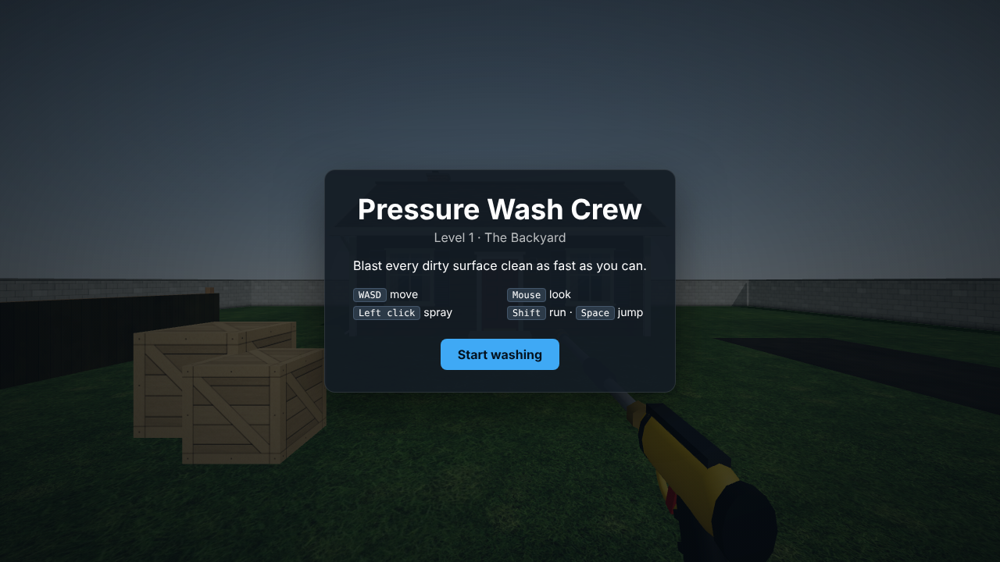 |  |
| `spawn` | 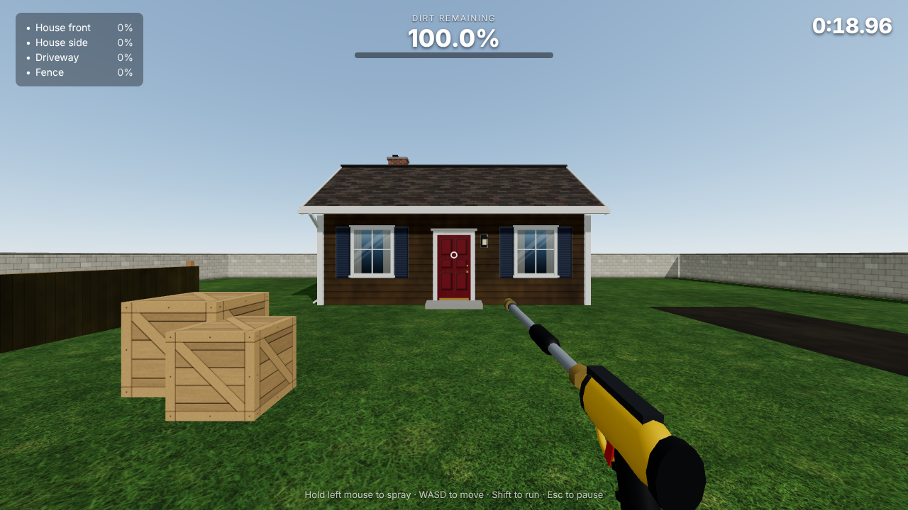 |  |
| `spawn-spraying` |  |  |
| `yard-overview` |  | 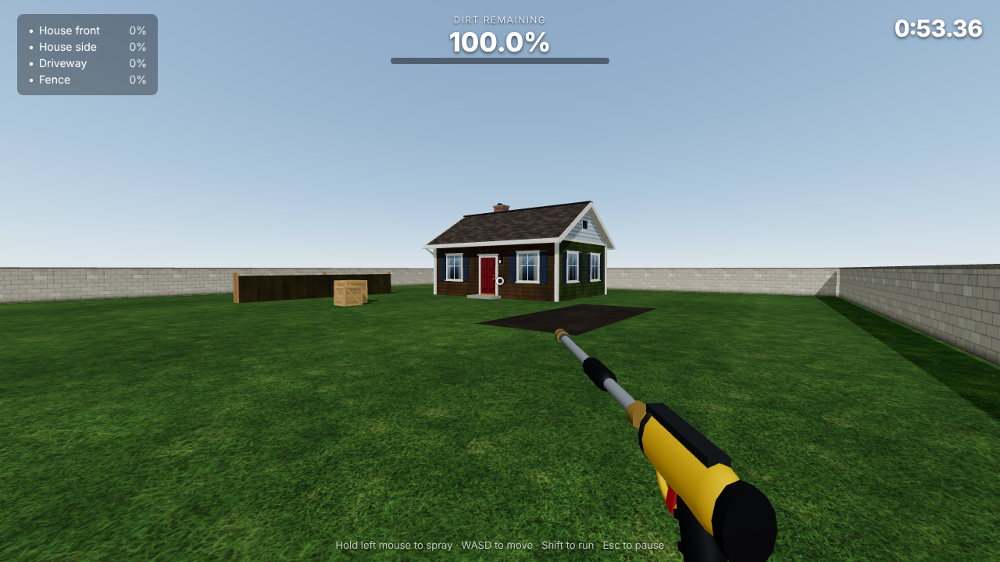 |
| `house-closeup-spraying` |  |  |
| `driveway-spraying` | 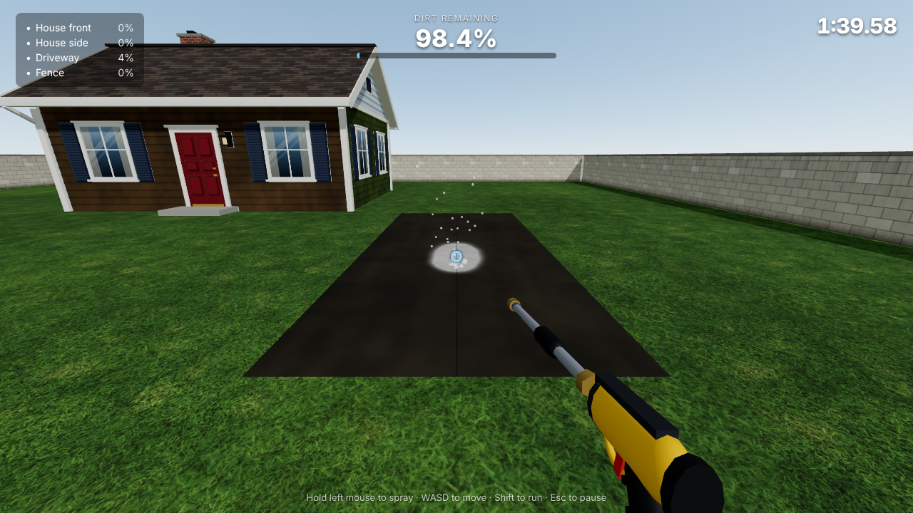 |  |
| `fence-closeup` |  | 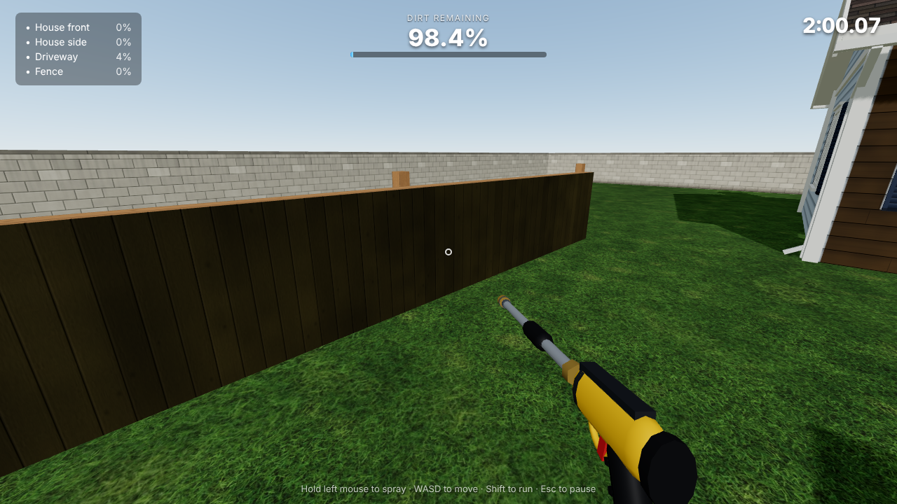 |
| `perimeter-wall` | 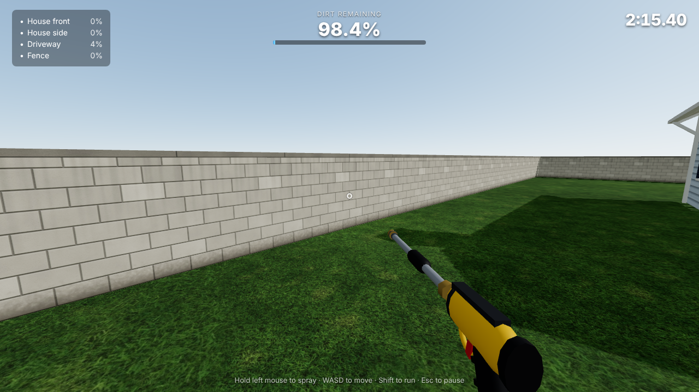 | 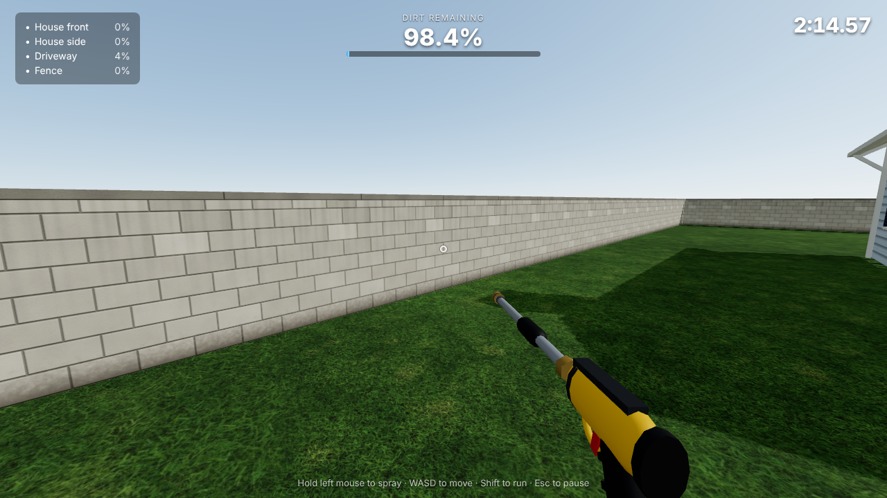 |
| `house-corner` |  | 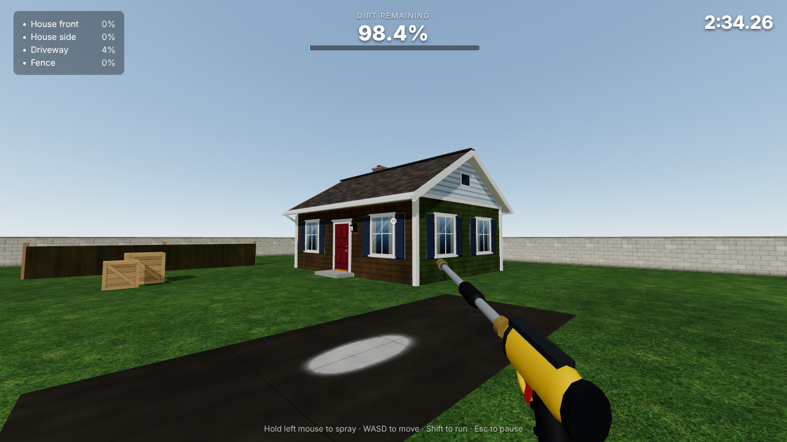 |
| `house-door-spraying` | 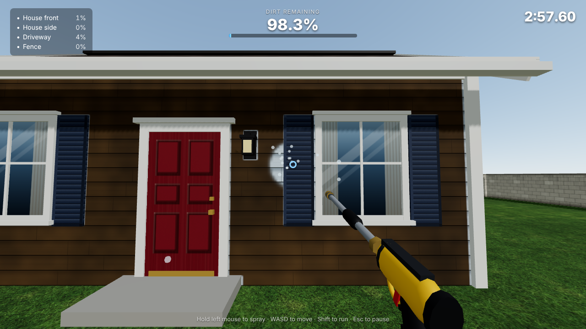 |  |
| `wall-celebration` | 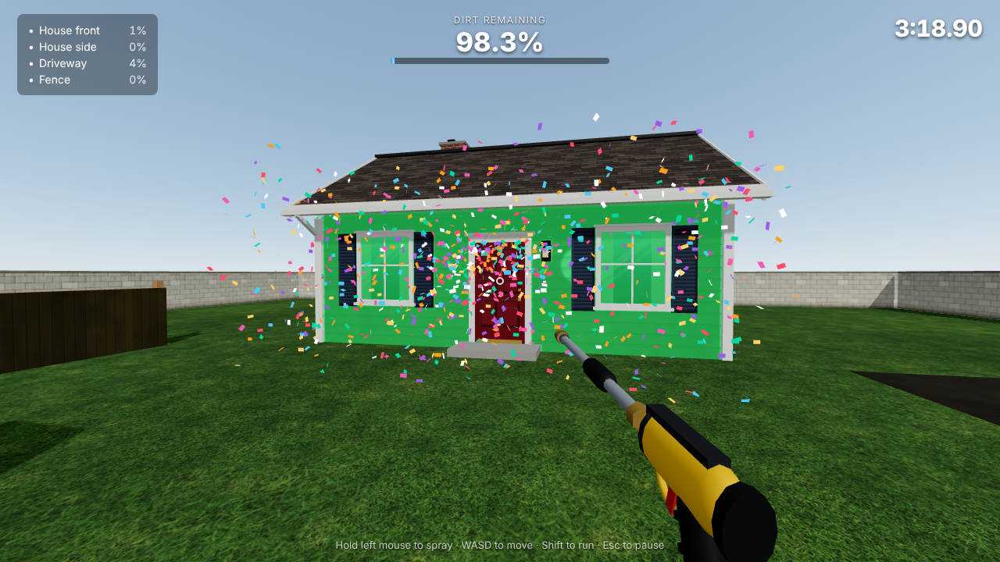 | 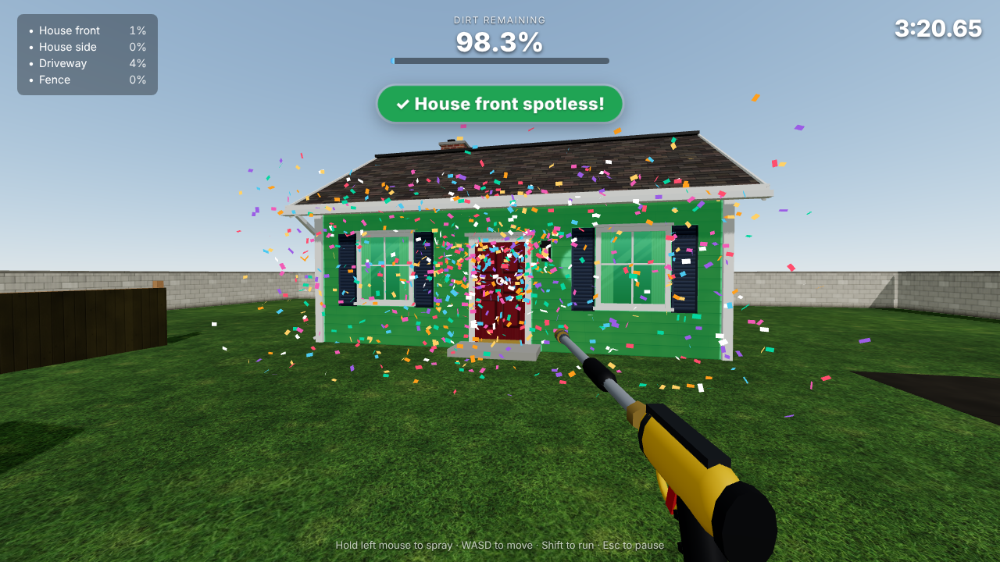 |

## Video walkthrough

Full video (after): [walkthrough.mp4](./after/walkthrough.mp4)

## Metrics

Target: **120 FPS = 8.33 ms/frame**. Frame time is the interval between frames with vsync off (real throughput); CPU is time spent in requestAnimationFrame callbacks (game logic + three.js draw submission); draw calls and triangles cover every pass, including the shadow map.

- Renderer: `ANGLE (Google, Vulkan 1.3.0 (SwiftShader Device (Subzero) (0x0000C0DE)), SwiftShader driver)` (headless), 1280×720, 4s × 1 sample(s) per view
- Before: `1ff931d` · After: `fe618e2`
- ⚠️ **Software GPU** (SwiftShader). Absolute FPS here is far below real hardware, so the 120 FPS column only checks CPU time per frame; judge by the before → after deltas, and re-run with `--headed` on a machine with a GPU for absolute numbers.

| View | Frame ms median (before → after) | Frame ms p95 | FPS | CPU ms median | Draw calls | Triangles | 120 FPS |
| --- | --- | --- | --- | --- | --- | --- | --- |
| `menu` | 232.90 → 231.60 (-0.6%) | 270.40 → 268.80 (-0.6%) | 4.2 → 4.3 (+0.9%) | 2.00 → 2.00 (+0.0%) | 30 → 30 (+0.0%) | 29,572 → 29,572 (+0.0%) | GPU n/a · CPU ✅ |
| `spawn` | 241.50 → 237.50 (-1.7%) | 275.90 → 273.30 (-0.9%) | 4.1 → 4.2 (+2.0%) | 1.80 → 1.70 (-5.6%) | 30 → 30 (+0.0%) | 29,572 → 29,572 (+0.0%) | GPU n/a · CPU ✅ |
| `spawn-spraying` | 237.40 → 242.40 (+2.1%) | 271.10 → 269.60 (-0.6%) | 4.2 → 4.1 (-1.9%) | 1.60 → 1.90 (+18.7%) | 30 → 30 (+0.0%) | 29,572 → 29,572 (+0.0%) | GPU n/a · CPU ✅ |
| `yard-overview` | 231.60 → 211.50 (-8.7%) | 257.10 → 237.00 (-7.8%) | 4.4 → 4.8 (+9.8%) | 1.50 → 1.50 (+0.0%) | 30 → 30 (+0.0%) | 29,572 → 29,572 (+0.0%) | GPU n/a · CPU ✅ |
| `house-closeup-spraying` | 311.90 → 312.70 (+0.3%) | 368.90 → 367.30 (-0.4%) | 3.2 → 3.2 (+0.1%) | 2.00 → 2.00 (+0.0%) | 27 → 27 (+0.0%) | 29,474 → 29,474 (+0.0%) | GPU n/a · CPU ✅ |
| `driveway-spraying` | 274.90 → 287.70 (+4.7%) | 315.90 → 340.50 (+7.8%) | 3.7 → 3.5 (-4.2%) | 2.00 → 2.00 (+0.0%) | 27 → 27 (+0.0%) | 29,474 → 29,474 (+0.0%) | GPU n/a · CPU ✅ |
| `fence-closeup` | 291.30 → 287.70 (-1.2%) | 347.60 → 324.00 (-6.8%) | 3.4 → 3.4 (+1.6%) | 1.60 → 1.50 (-6.2%) | 25 → 25 (+0.0%) | 29,520 → 29,520 (+0.0%) | GPU n/a · CPU ✅ |
| `perimeter-wall` | 169.20 → 179.20 (+5.9%) | 197.10 → 206.20 (+4.6%) | 5.9 → 5.6 (-5.3%) | 1.30 → 1.50 (+15.4%) | 23 → 23 (+0.0%) | 29,446 → 29,446 (+0.0%) | GPU n/a · CPU ✅ |
| `house-corner` | 228.20 → 256.70 (+12.5%) | 262.70 → 298.10 (+13.5%) | 4.3 → 3.8 (-11.6%) | 1.50 → 1.50 (+0.0%) | 30 → 30 (+0.0%) | 29,572 → 29,572 (+0.0%) | GPU n/a · CPU ✅ |
| `house-door-spraying` | 357.90 → 367.30 (+2.6%) | 411.70 → 459.70 (+11.7%) | 2.8 → 2.7 (-5.0%) | 1.90 → 2.00 (+5.3%) | 26 → 26 (+0.0%) | 29,472 → 29,472 (+0.0%) | GPU n/a · CPU ✅ |
| `wall-celebration` | 274.00 → 277.60 (+1.3%) | 312.30 → 311.50 (-0.3%) | 3.6 → 3.6 (-0.7%) | 1.70 → 1.90 (+11.8%) | 34 → 34 (+0.0%) | 31,578 → 31,578 (+0.0%) | GPU n/a · CPU ✅ |

Suggested-risk thresholds: triangles or draw calls +25% ⇒ High, +5% ⇒ Medium. Frame time (software GPU, ±10% noise is normal): +25% ⇒ High, +10% ⇒ Medium.

### Against the main baseline

- Baseline: `d879b16` recorded 2026-11-24 on MacBook Pro (Mac15,6), Apple M3 Pro: `ANGLE (Apple, ANGLE Metal Renderer: Apple M3 Pro, Unspecified Version)` (headed), chrome 158.0.8127.37, 1280×720, 3 runs × 3 samples, vsync off.
- This capture ran on `ANGLE (Google, Vulkan 1.3.0 (SwiftShader Device (Subzero) (0x0000C0DE)), SwiftShader driver)` (headless), 1280×720, not the baseline's setup, so only draw calls and triangles (which don't depend on the machine) are compared. For frame time against the baseline, run `pnpm pr:capture --headed --channel chrome` on the baseline machine.
- main has moved since the baseline (`d879b16` → `1ff931d`). A regression that **Before** also shows came from main, not this PR, and only counts as main drift.

| View | FPS (baseline → after) | Frame ms mean | Frame ms p95 | CPU ms mean | Draw calls | Triangles | vs baseline |
| --- | --- | --- | --- | --- | --- | --- | --- |
| `menu` | _n/a_ | _n/a_ | _n/a_ | _n/a_ | 29 → 30 (+3.4%) | 25,516 → 29,572 (+15.9%) | ↔️ main drift: triangles +15.9% |
| `spawn` | _n/a_ | _n/a_ | _n/a_ | _n/a_ | 29 → 30 (+3.4%) | 25,516 → 29,572 (+15.9%) | ↔️ main drift: triangles +15.9% |
| `spawn-spraying` | _n/a_ | _n/a_ | _n/a_ | _n/a_ | 29 → 30 (+3.4%) | 25,516 → 29,572 (+15.9%) | ↔️ main drift: triangles +15.9% |
| `yard-overview` | _n/a_ | _n/a_ | _n/a_ | _n/a_ | 29 → 30 (+3.4%) | 25,516 → 29,572 (+15.9%) | ↔️ main drift: triangles +15.9% |
| `house-closeup-spraying` | _n/a_ | _n/a_ | _n/a_ | _n/a_ | 25 → 27 (+8.0%) | 25,478 → 29,474 (+15.7%) | ↔️ main drift: triangles +15.7%, draw calls +8.0% |
| `driveway-spraying` | _not in baseline_ | | | | | | 🆕 new view |
| `fence-closeup` | _not in baseline_ | | | | | | 🆕 new view |
| `perimeter-wall` | _not in baseline_ | | | | | | 🆕 new view |
| `house-corner` | _not in baseline_ | | | | | | 🆕 new view |
| `house-door-spraying` | _not in baseline_ | | | | | | 🆕 new view |
| `wall-celebration` | _not in baseline_ | | | | | | 🆕 new view |

↔️ `menu`, `spawn`, `spawn-spraying`, `yard-overview`, `house-closeup-spraying`: main (Before) is already this far from the baseline, so it doesn't count against this PR. If main got slower on purpose, refresh the baseline with `pnpm perf:baseline`; if not, it needs a look.

<!-- suggested-risk: Medium (`house-corner` frame time +30.26 ms (+13.1%)) -->
