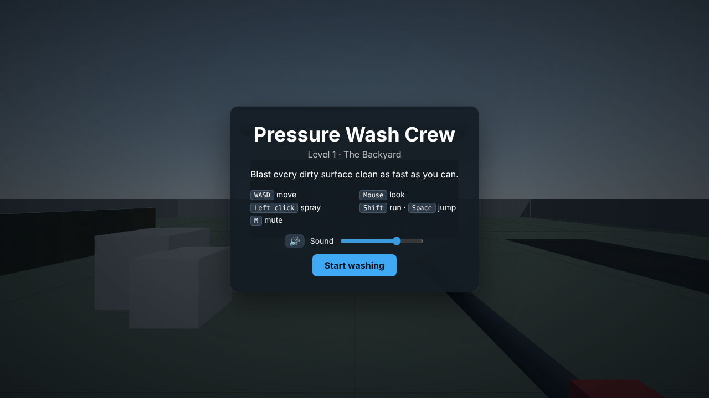
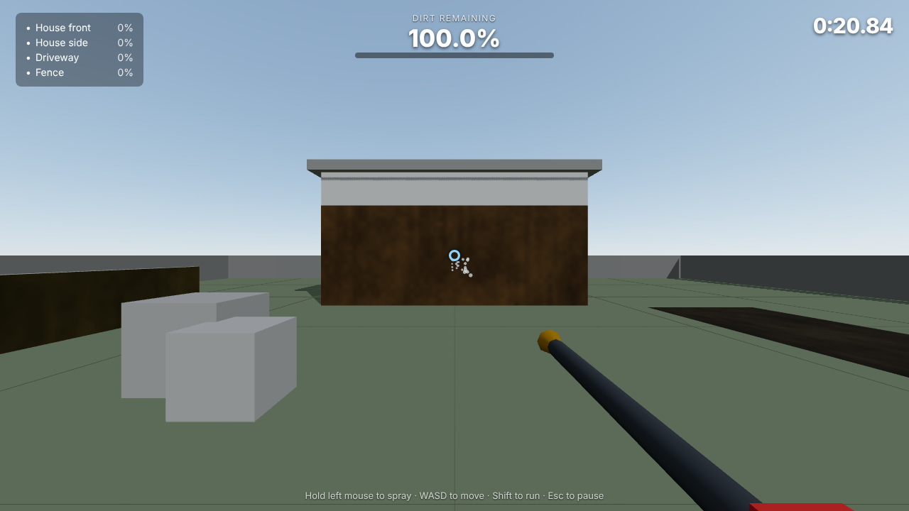
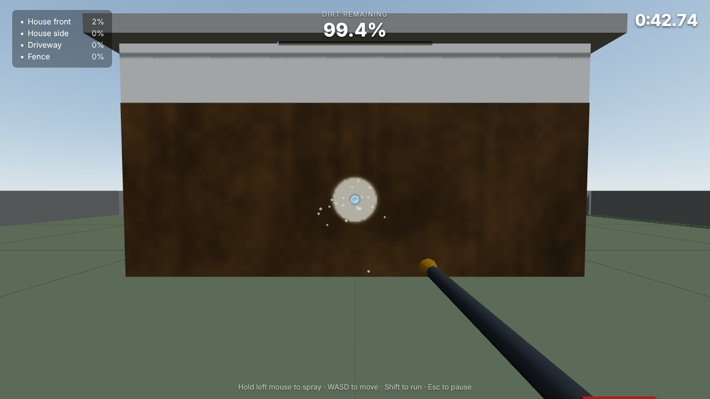
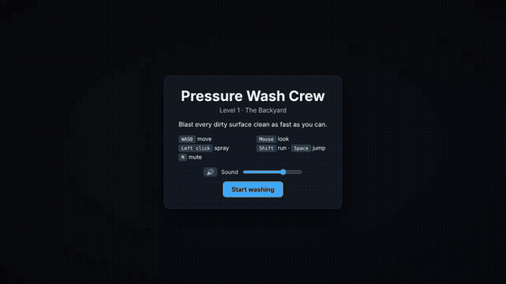

## Screenshots

| View | Before | After |
| --- | --- | --- |
| `menu` |  |  |
| `spawn` |  |  |
| `spawn-spraying` |  |  |
| `yard-overview` |  |  |
| `house-closeup-spraying` |  |  |

## Video walkthrough

Full video (after): [walkthrough.mp4](./after/walkthrough.mp4)

## Metrics

Target: **120 FPS = 8.33 ms/frame**. Frame time is the interval between frames with vsync off (real throughput); CPU is time spent in requestAnimationFrame callbacks (game logic + three.js draw submission); draw calls and triangles cover every pass, including the shadow map.

- Renderer: `ANGLE (Google, Vulkan 1.3.0 (SwiftShader Device (Subzero) (0x0000C0DE)), SwiftShader driver)` (headless), 1280×720, 4s sample per view
- Before: `d879b16` · After: `84e7c9b`
- ⚠️ **Software GPU** (SwiftShader). Absolute FPS here is far below real hardware, so the 120 FPS column only checks CPU time per frame; judge by the before → after deltas, and re-run with `--headed` on a machine with a GPU for absolute numbers.

| View | Frame ms median (before → after) | Frame ms p95 | FPS | CPU ms median | Draw calls | Triangles | 120 FPS |
| --- | --- | --- | --- | --- | --- | --- | --- |
| `menu` | 131.80 → 128.80 (-2.3%) | 158.60 → 142.70 (-10.0%) | 7.4 → 7.8 (+4.9%) | 1.50 → 1.40 (-6.7%) | 29 → 29 (+0.0%) | 25,516 → 25,516 (+0.0%) | GPU n/a · CPU ✅ |
| `spawn` | 129.20 → 130.00 (+0.6%) | 159.90 → 147.00 (-8.1%) | 7.7 → 7.8 (+0.5%) | 1.20 → 1.20 (+0.0%) | 29 → 29 (+0.0%) | 25,516 → 25,516 (+0.0%) | GPU n/a · CPU ✅ |
| `spawn-spraying` | 126.00 → 126.70 (+0.6%) | 151.40 → 144.10 (-4.8%) | 8.0 → 7.9 (-0.3%) | 1.30 → 1.30 (+0.0%) | 29 → 29 (+0.0%) | 25,516 → 25,516 (+0.0%) | GPU n/a · CPU ✅ |
| `yard-overview` | 116.60 → 124.30 (+6.6%) | 136.50 → 139.80 (+2.4%) | 8.4 → 8.0 (-4.9%) | 1.10 → 1.20 (+9.1%) | 29 → 29 (+0.0%) | 25,516 → 25,516 (+0.0%) | GPU n/a · CPU ✅ |
| `house-closeup-spraying` | 147.00 → 145.90 (-0.7%) | 169.60 → 175.40 (+3.4%) | 6.9 → 6.7 (-3.0%) | 1.30 → 1.40 (+7.7%) | 25 → 25 (+0.0%) | 25,478 → 25,478 (+0.0%) | GPU n/a · CPU ✅ |

Thresholds for the suggested risk: frame time +25% / triangles or draw calls +25% ⇒ High; +10% / +5% ⇒ Medium. Frame-time bands are wider on a software GPU (±10% run-to-run noise is normal there).

<!-- suggested-risk: Low -->
