## Screenshots

| View | Before | After |
| --- | --- | --- |
| `menu` | 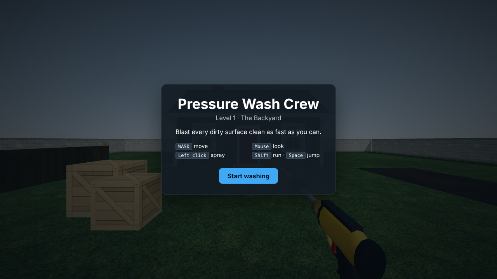 |  |
| `spawn` |  | 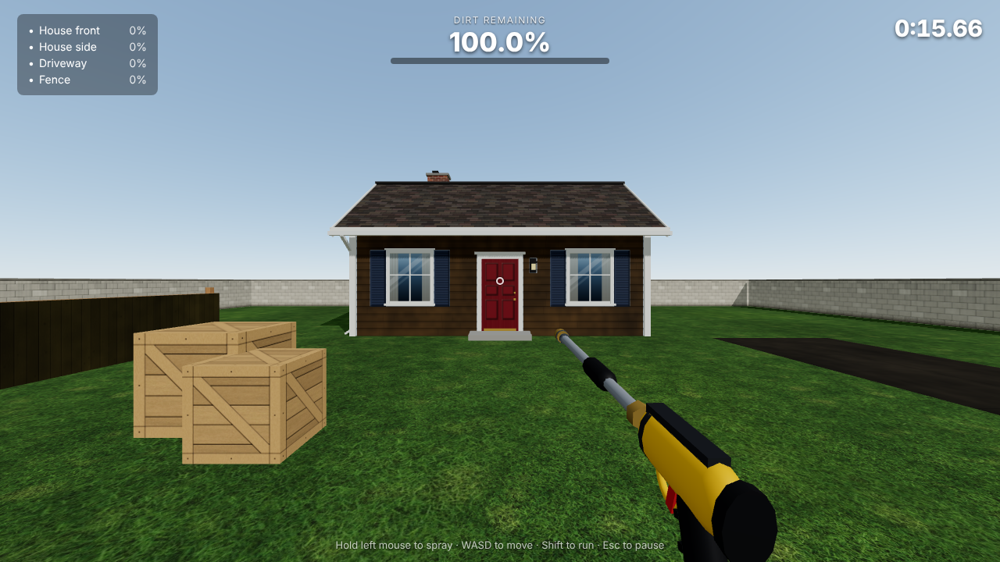 |
| `spawn-spraying` | 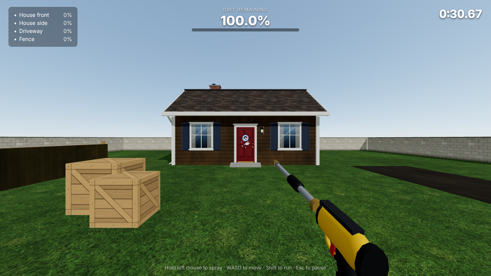 | 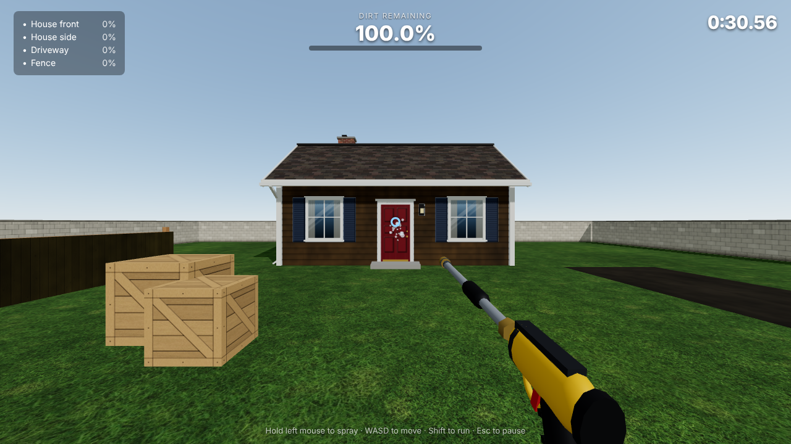 |
| `yard-overview` | 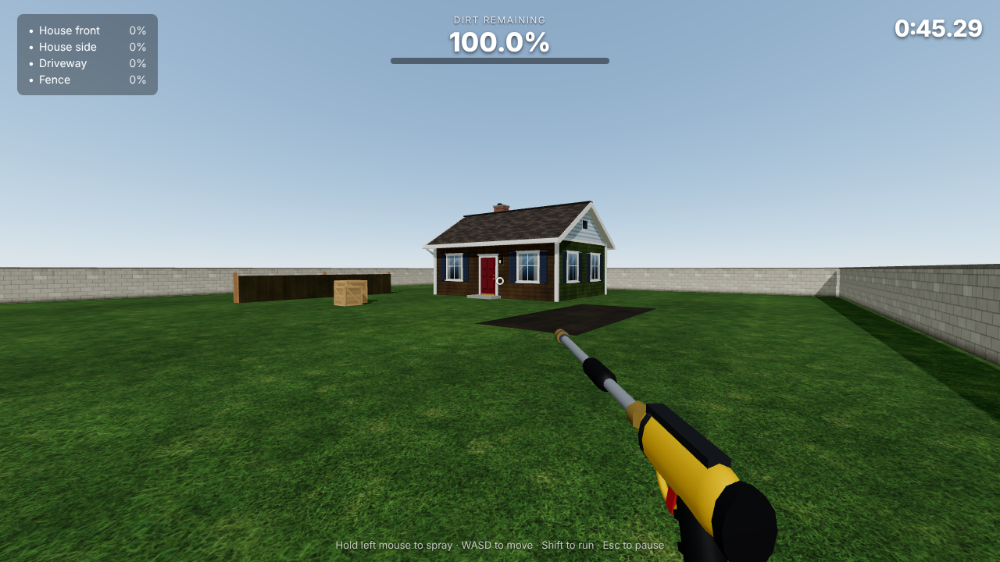 |  |
| `house-closeup-spraying` | 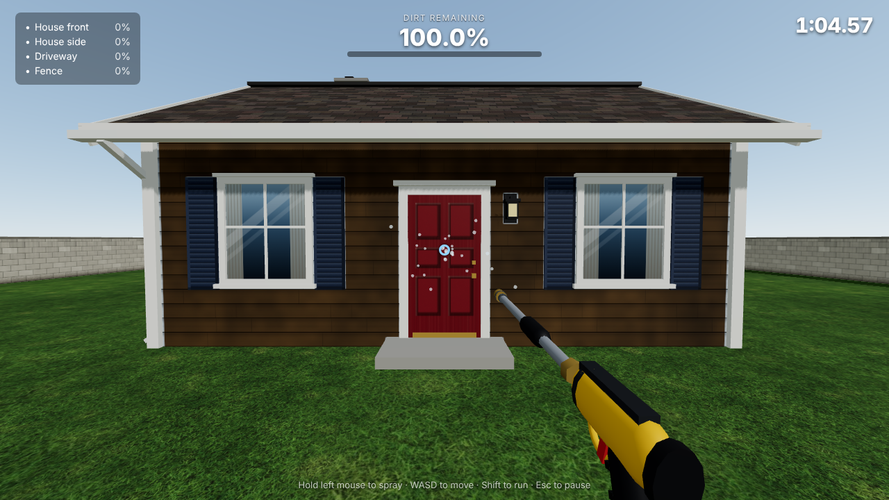 |  |
| `driveway-spraying` |  | 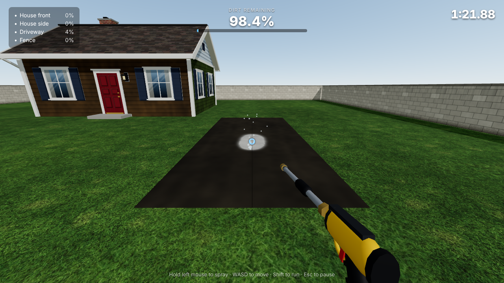 |
| `fence-closeup` |  | 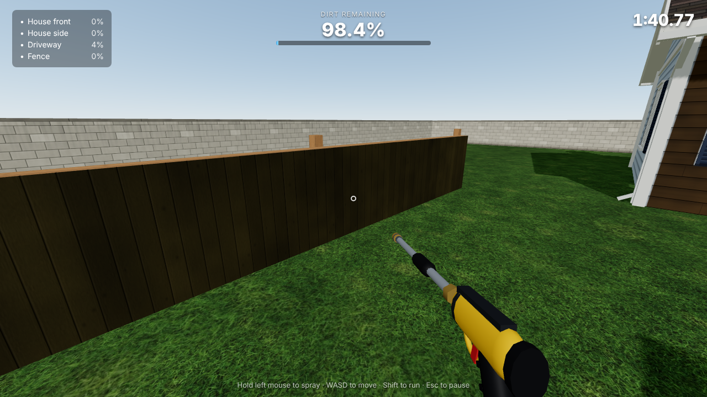 |
| `perimeter-wall` |  | 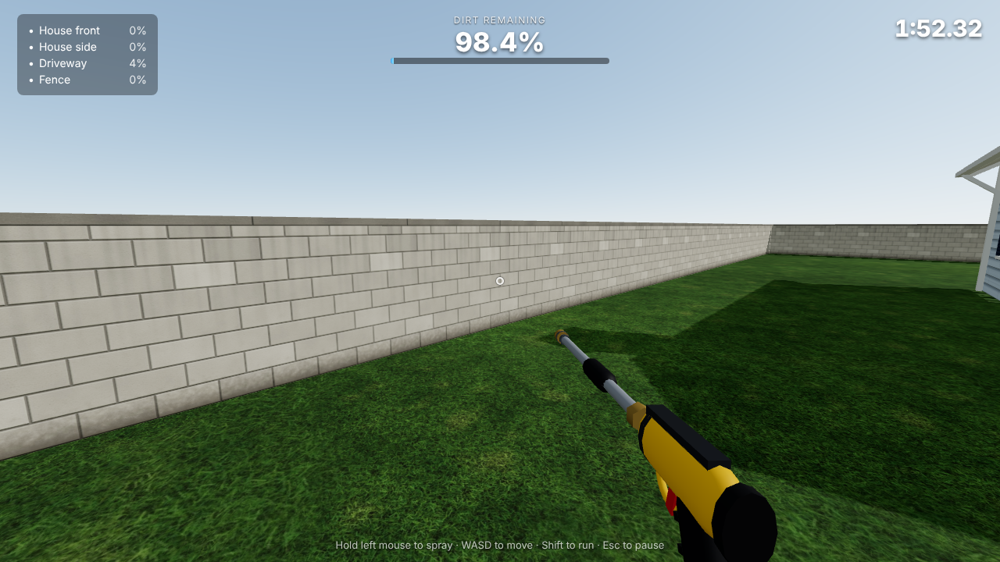 |
| `house-corner` | 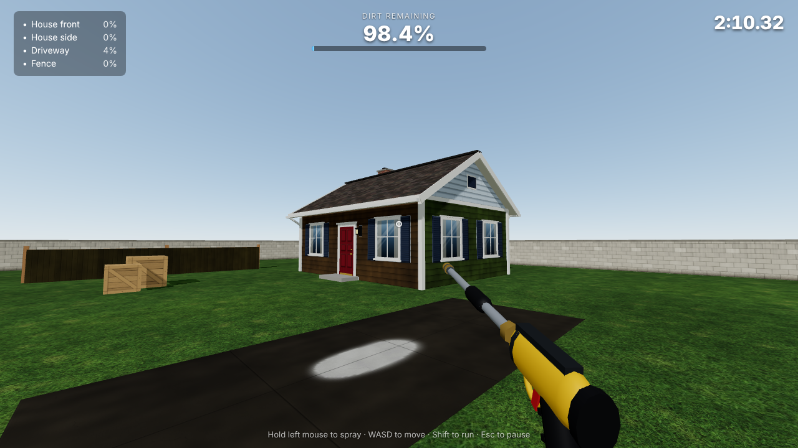 |  |
| `house-door-spraying` | 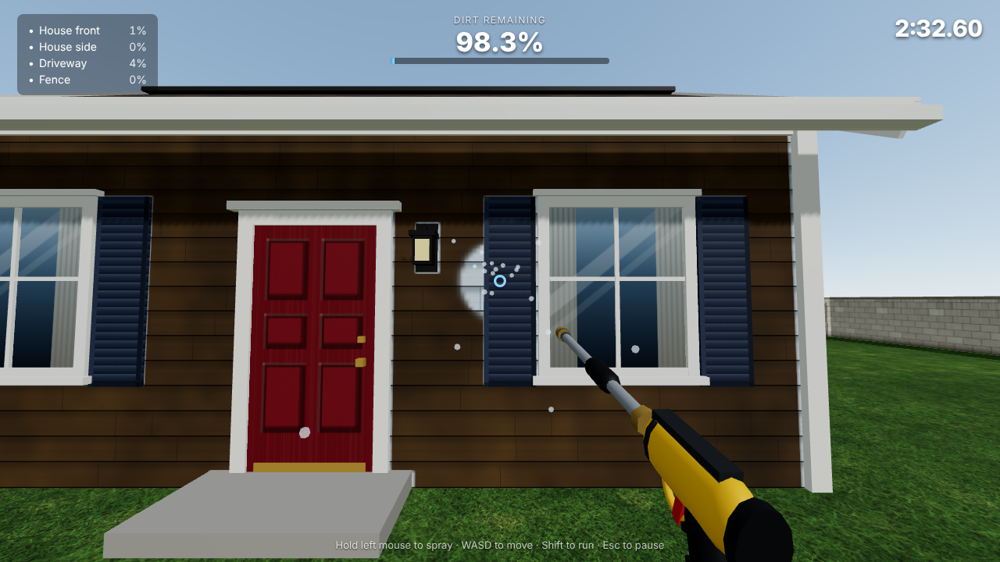 | 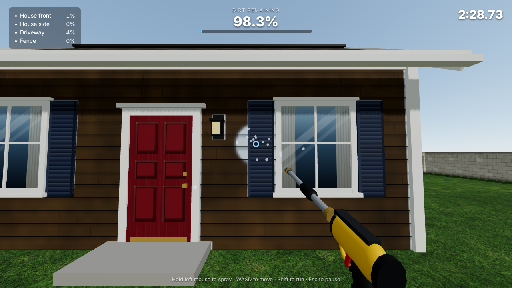 |
| `wall-celebration` | 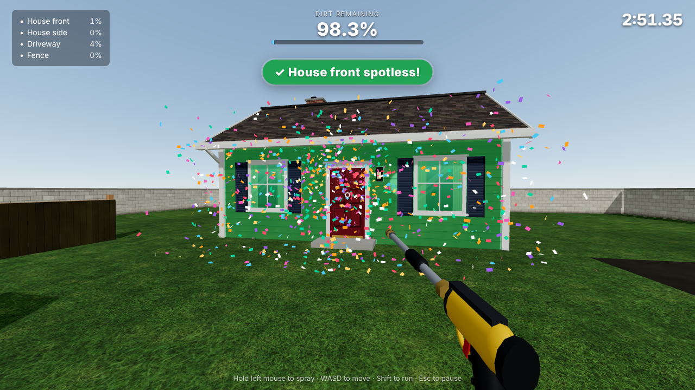 | 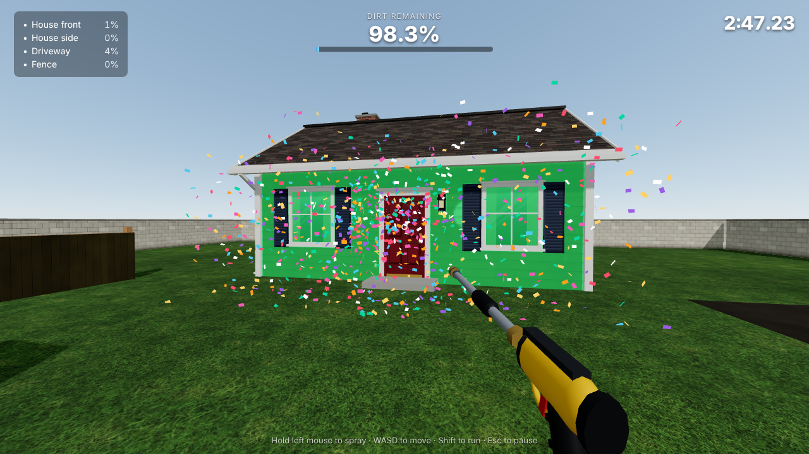 |

## Video walkthrough

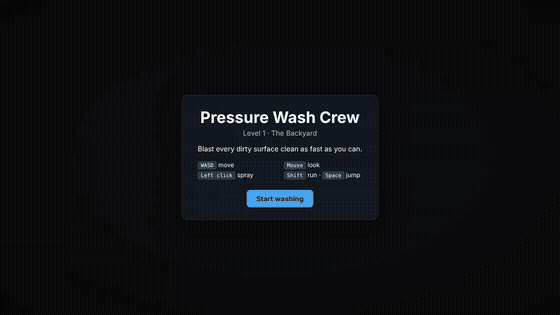
Full video (after): [walkthrough.mp4](./after/walkthrough.mp4)

## Metrics

Target: **120 FPS = 8.33 ms/frame**. Frame time is the interval between frames with vsync off (real throughput); CPU is time spent in requestAnimationFrame callbacks (game logic + three.js draw submission); draw calls and triangles cover every pass, including the shadow map.

- Renderer: `ANGLE (Google, Vulkan 1.3.0 (SwiftShader Device (Subzero) (0x0000C0DE)), SwiftShader driver)` (headless), playwright chromium 158.0.8127.36, 1280×720, 4s × 1 sample(s) per view
- Before: `375b2c5` · After: `8498bdb`
- ⚠️ **Software GPU** (SwiftShader). Absolute FPS here is far below real hardware, so the 120 FPS column only checks CPU time per frame; judge by the before → after deltas, and re-run with `--headed` on a machine with a GPU for absolute numbers.

| View | Frame ms median (before → after) | Frame ms p95 | FPS | CPU ms median | Draw calls | Triangles | 120 FPS |
| --- | --- | --- | --- | --- | --- | --- | --- |
| `menu` | 192.00 → 192.20 (+0.1%) | 220.60 → 224.50 (+1.8%) | 5.1 → 5.1 (+0.1%) | 1.70 → 1.90 (+11.8%) | 30 → 30 (+0.0%) | 29,572 → 29,572 (+0.0%) | GPU n/a · CPU ✅ |
| `spawn` | 195.10 → 197.10 (+1.0%) | 235.00 → 225.90 (-3.9%) | 5.0 → 5.0 (-0.3%) | 1.50 → 1.50 (+0.0%) | 30 → 30 (+0.0%) | 29,572 → 29,572 (+0.0%) | GPU n/a · CPU ✅ |
| `spawn-spraying` | 192.60 → 193.30 (+0.4%) | 231.00 → 212.00 (-8.2%) | 5.2 → 5.1 (-0.2%) | 1.60 → 1.70 (+6.2%) | 30 → 30 (+0.0%) | 29,572 → 29,572 (+0.0%) | GPU n/a · CPU ✅ |
| `yard-overview` | 184.70 → 183.30 (-0.8%) | 207.10 → 207.00 (-0.0%) | 5.4 → 5.5 (+1.1%) | 1.20 → 1.30 (+8.3%) | 30 → 30 (+0.0%) | 29,572 → 29,572 (+0.0%) | GPU n/a · CPU ✅ |
| `house-closeup-spraying` | 251.50 → 249.00 (-1.0%) | 291.80 → 288.60 (-1.1%) | 3.9 → 4.0 (+1.0%) | 1.50 → 1.70 (+13.3%) | 27 → 27 (+0.0%) | 29,474 → 29,474 (+0.0%) | GPU n/a · CPU ✅ |
| `driveway-spraying` | 229.40 → 224.50 (-2.1%) | 263.70 → 255.80 (-3.0%) | 4.4 → 4.4 (+1.3%) | 1.70 → 1.70 (+0.0%) | 27 → 27 (+0.0%) | 29,474 → 29,474 (+0.0%) | GPU n/a · CPU ✅ |
| `fence-closeup` | 247.30 → 238.30 (-3.6%) | 332.90 → 277.20 (-16.7%) | 3.9 → 4.1 (+6.2%) | 1.40 → 1.40 (+0.0%) | 25 → 25 (+0.0%) | 29,520 → 29,520 (+0.0%) | GPU n/a · CPU ✅ |
| `perimeter-wall` | 147.20 → 140.90 (-4.3%) | 169.80 → 157.10 (-7.5%) | 6.8 → 7.1 (+4.7%) | 1.20 → 1.20 (+0.0%) | 23 → 23 (+0.0%) | 29,446 → 29,446 (+0.0%) | GPU n/a · CPU ✅ |
| `house-corner` | 207.00 → 193.90 (-6.3%) | 297.30 → 219.80 (-26.1%) | 4.6 → 5.1 (+11.3%) | 1.40 → 1.30 (-7.1%) | 30 → 30 (+0.0%) | 29,572 → 29,572 (+0.0%) | GPU n/a · CPU ✅ |
| `house-door-spraying` | 297.70 → 287.70 (-3.4%) | 326.40 → 352.30 (+7.9%) | 3.3 → 3.4 (+1.7%) | 1.60 → 1.50 (-6.3%) | 26 → 26 (+0.0%) | 29,472 → 29,472 (+0.0%) | GPU n/a · CPU ✅ |
| `wall-celebration` | 232.30 → 236.00 (+1.6%) | 266.60 → 275.70 (+3.4%) | 4.3 → 4.2 (-2.0%) | 1.50 → 1.50 (+0.0%) | 34 → 34 (+0.0%) | 31,578 → 31,578 (+0.0%) | GPU n/a · CPU ✅ |

Suggested-risk thresholds: triangles or draw calls +25% ⇒ High, +5% ⇒ Medium. Frame time (software GPU, ±10% noise is normal): +25% ⇒ High, +10% ⇒ Medium.

### Against the main baseline

- Baseline: `d879b16` recorded 2026-11-24 on MacBook Pro (Mac15,6), Apple M3 Pro: `ANGLE (Apple, ANGLE Metal Renderer: Apple M3 Pro, Unspecified Version)` (headed), chrome 158.0.8127.37, 1280×720, 3 runs × 3 samples, vsync off.
- This capture ran on `ANGLE (Google, Vulkan 1.3.0 (SwiftShader Device (Subzero) (0x0000C0DE)), SwiftShader driver)` (headless), playwright chromium 158.0.8127.36, 1280×720, not the baseline's setup, so only draw calls and triangles (which don't depend on the machine) are compared. For frame time against the baseline, run `pnpm pr:capture --headed --channel chrome` on the baseline machine.
- main has moved since the baseline (`d879b16` → `375b2c5`). A regression that **Before** also shows came from main, not this PR, and only counts as main drift.

| View | FPS (baseline → after) | Frame ms mean | Frame ms p95 | CPU ms mean | Draw calls | Triangles | vs baseline |
| --- | --- | --- | --- | --- | --- | --- | --- |
| `menu` | _n/a_ | _n/a_ | _n/a_ | _n/a_ | 29 → 30 (+3.4%) | 25,516 → 29,572 (+15.9%) | ↔️ main drift: triangles +15.9% |
| `spawn` | _n/a_ | _n/a_ | _n/a_ | _n/a_ | 29 → 30 (+3.4%) | 25,516 → 29,572 (+15.9%) | ↔️ main drift: triangles +15.9% |
| `spawn-spraying` | _n/a_ | _n/a_ | _n/a_ | _n/a_ | 29 → 30 (+3.4%) | 25,516 → 29,572 (+15.9%) | ↔️ main drift: triangles +15.9% |
| `yard-overview` | _n/a_ | _n/a_ | _n/a_ | _n/a_ | 29 → 30 (+3.4%) | 25,516 → 29,572 (+15.9%) | ↔️ main drift: triangles +15.9% |
| `house-closeup-spraying` | _n/a_ | _n/a_ | _n/a_ | _n/a_ | 25 → 27 (+8.0%) | 25,478 → 29,474 (+15.7%) | ↔️ main drift: triangles +15.7%, draw calls +8.0% |
| `driveway-spraying` | _not in baseline_ | | | | | | 🆕 new view |
| `fence-closeup` | _not in baseline_ | | | | | | 🆕 new view |
| `perimeter-wall` | _not in baseline_ | | | | | | 🆕 new view |
| `house-corner` | _not in baseline_ | | | | | | 🆕 new view |
| `house-door-spraying` | _not in baseline_ | | | | | | 🆕 new view |
| `wall-celebration` | _not in baseline_ | | | | | | 🆕 new view |

↔️ `menu`, `spawn`, `spawn-spraying`, `yard-overview`, `house-closeup-spraying`: main (Before) is already this far from the baseline, so it doesn't count against this PR. If main got slower on purpose, refresh the baseline with `pnpm perf:baseline`; if not, it needs a look.

<!-- suggested-risk: Low -->
