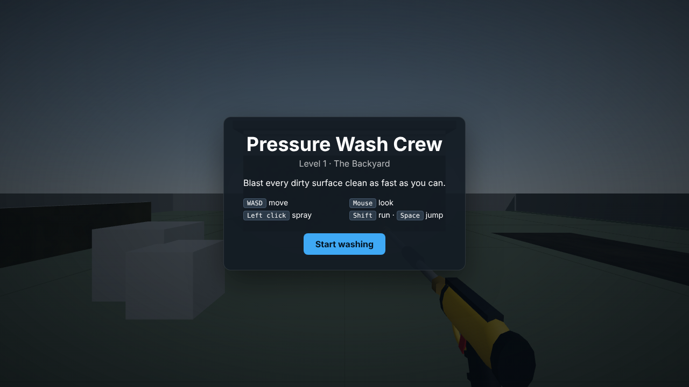
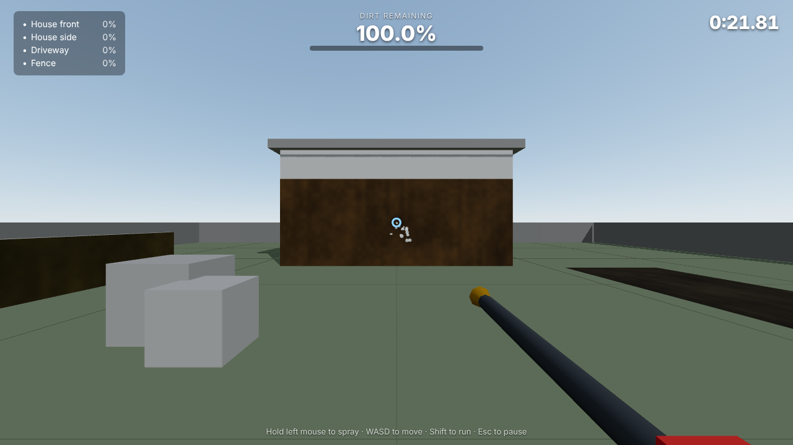
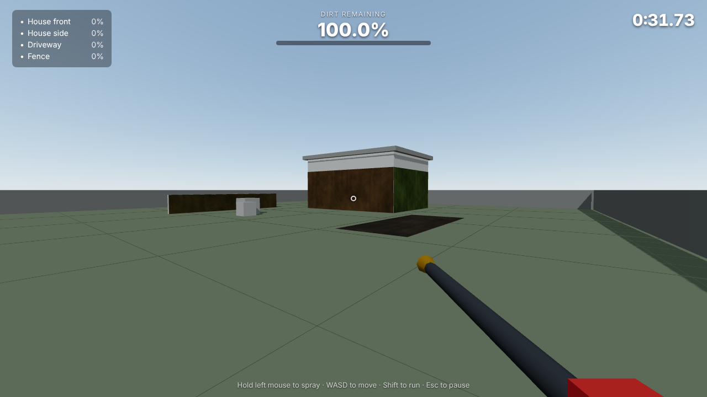
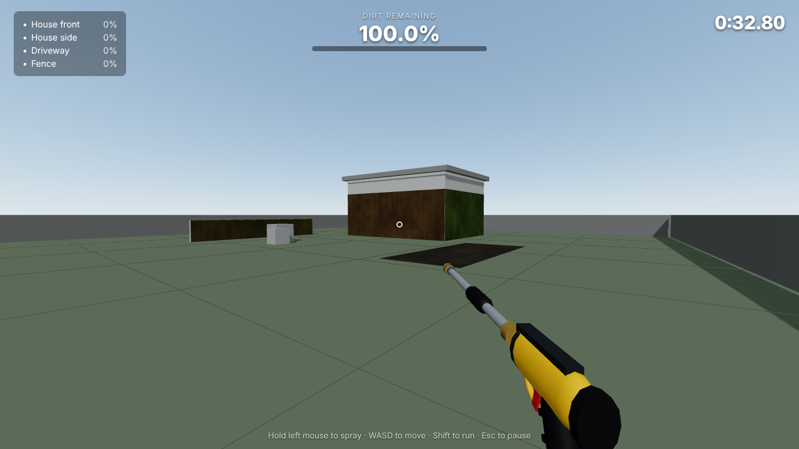
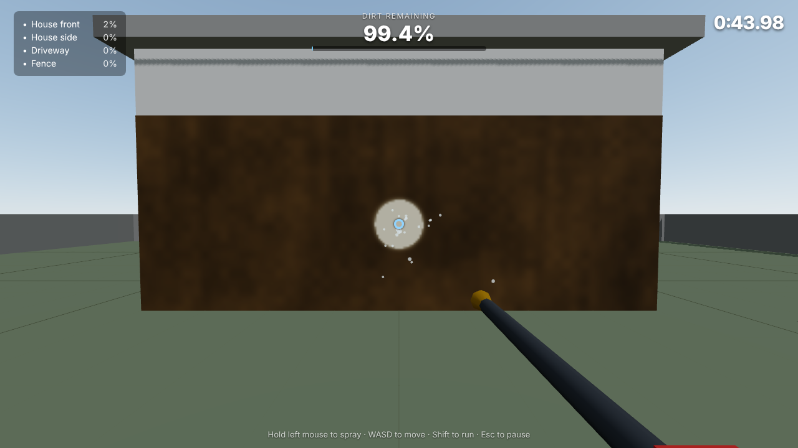
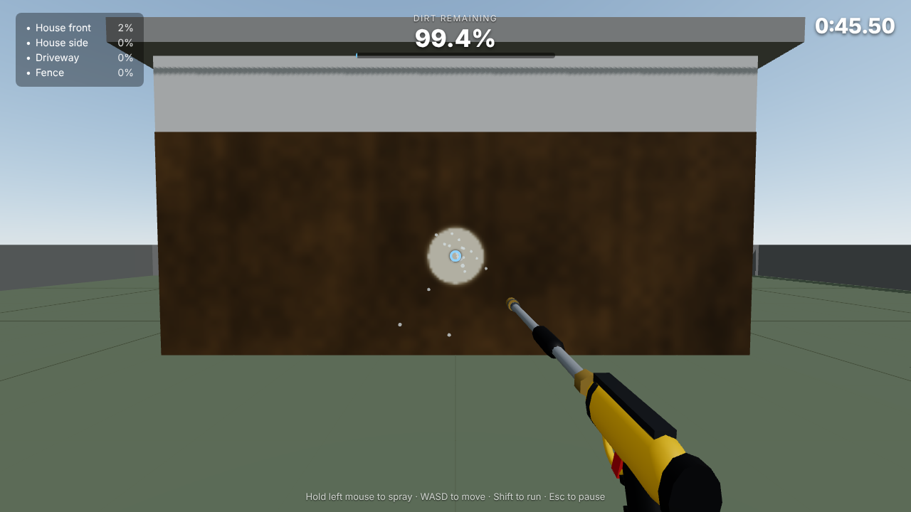
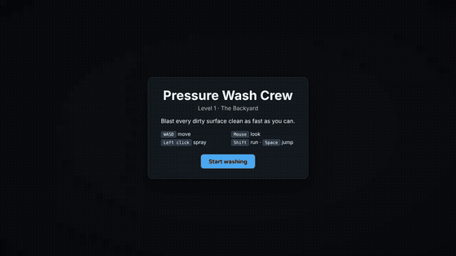

## Screenshots

| View | Before | After |
| --- | --- | --- |
| `menu` |  |  |
| `spawn` |  |  |
| `spawn-spraying` |  |  |
| `yard-overview` |  |  |
| `house-closeup-spraying` |  |  |

## Video walkthrough

Full video (after): [walkthrough.mp4](./after/walkthrough.mp4)

## Metrics

Target: **120 FPS = 8.33 ms/frame**. Frame time is the interval between frames with vsync off (real throughput); CPU is time spent in requestAnimationFrame callbacks (game logic + three.js draw submission); draw calls and triangles cover every pass, including the shadow map.

- Renderer: `ANGLE (Google, Vulkan 1.3.0 (SwiftShader Device (Subzero) (0x0000C0DE)), SwiftShader driver)` (headless), 1280×720, 4s sample per view
- Before: `a808355` · After: `a6a7682`
- ⚠️ **Software GPU** (SwiftShader). Absolute FPS here is far below real hardware, so the 120 FPS column only checks CPU time per frame; judge by the before → after deltas, and re-run with `--headed` on a machine with a GPU for absolute numbers.

| View | Frame ms median (before → after) | Frame ms p95 | FPS | CPU ms median | Draw calls | Triangles | 120 FPS |
| --- | --- | --- | --- | --- | --- | --- | --- |
| `menu` | 144.00 → 144.80 (+0.6%) | 164.60 → 164.30 (-0.2%) | 7.0 → 7.0 (-0.6%) | 1.60 → 1.60 (-0.0%) | 29 → 29 (+0.0%) | 25,516 → 26,608 (+4.3%) | GPU n/a · CPU ✅ |
| `spawn` | 133.90 → 143.30 (+7.0%) | 158.90 → 166.30 (+4.7%) | 7.4 → 7.1 (-3.8%) | 1.40 → 1.50 (+7.1%) | 29 → 29 (+0.0%) | 25,516 → 26,608 (+4.3%) | GPU n/a · CPU ✅ |
| `spawn-spraying` | 126.00 → 132.40 (+5.1%) | 150.90 → 150.70 (-0.1%) | 8.0 → 7.6 (-4.5%) | 1.40 → 1.40 (+0.0%) | 29 → 29 (+0.0%) | 25,516 → 26,608 (+4.3%) | GPU n/a · CPU ✅ |
| `yard-overview` | 119.30 → 130.20 (+9.1%) | 148.60 → 154.10 (+3.7%) | 8.1 → 7.7 (-5.4%) | 1.20 → 1.20 (+0.0%) | 29 → 29 (+0.0%) | 25,516 → 26,608 (+4.3%) | GPU n/a · CPU ✅ |
| `house-closeup-spraying` | 152.40 → 164.10 (+7.7%) | 189.40 → 196.80 (+3.9%) | 6.5 → 6.1 (-6.4%) | 1.30 → 1.80 (+38.5%) | 25 → 25 (+0.0%) | 25,478 → 26,570 (+4.3%) | GPU n/a · CPU ✅ |

Thresholds for the suggested risk: frame time +25% / triangles or draw calls +25% ⇒ High; +10% / +5% ⇒ Medium. Frame-time bands are wider on a software GPU (±10% run-to-run noise is normal there).

<!-- suggested-risk: Low -->
