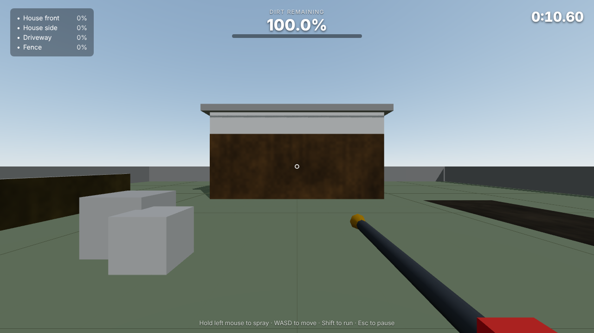
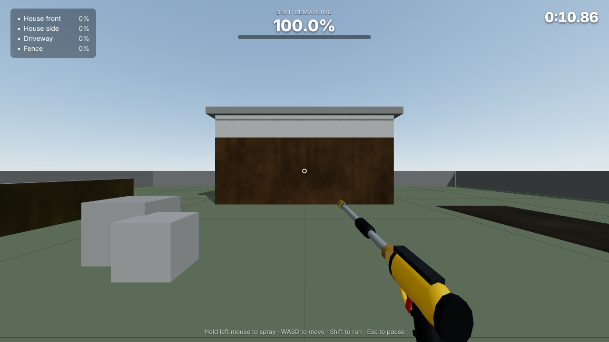
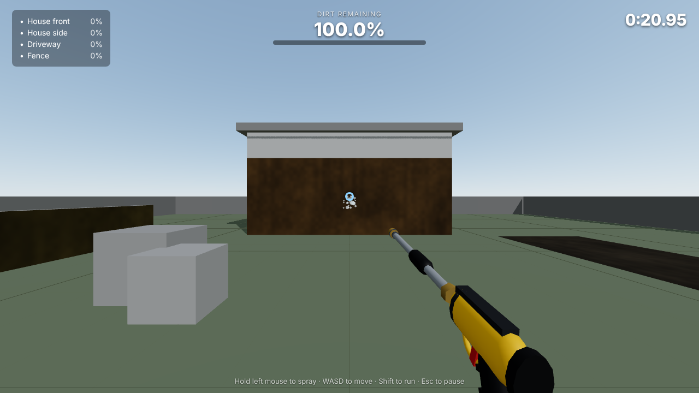

## Screenshots

| View | Before | After |
| --- | --- | --- |
| `menu` |  |  |
| `spawn` |  |  |
| `spawn-spraying` |  |  |
| `yard-overview` |  |  |
| `house-closeup-spraying` |  |  |

## Video walkthrough

Full video (after): [walkthrough.mp4](./after/walkthrough.mp4)

## Metrics

Target: **120 FPS = 8.33 ms/frame**. Frame time is the interval between frames with vsync off (real throughput); CPU is time spent in requestAnimationFrame callbacks (game logic + three.js draw submission); draw calls and triangles cover every pass, including the shadow map.

- Renderer: `ANGLE (Google, Vulkan 1.3.0 (SwiftShader Device (Subzero) (0x0000C0DE)), SwiftShader driver)` (headless), 1280×720, 4s sample per view
- Before: `d879b16` · After: `ffdc839`
- ⚠️ **Software GPU** (SwiftShader). Absolute FPS here is far below real hardware, so the 120 FPS column only checks CPU time per frame; judge by the before → after deltas, and re-run with `--headed` on a machine with a GPU for absolute numbers.

| View | Frame ms median (before → after) | Frame ms p95 | FPS | CPU ms median | Draw calls | Triangles | 120 FPS |
| --- | --- | --- | --- | --- | --- | --- | --- |
| `menu` | 119.60 → 131.50 (+9.9%) | 133.00 → 151.10 (+13.6%) | 8.4 → 7.5 (-10.1%) | 1.30 → 1.40 (+7.7%) | 29 → 29 (+0.0%) | 25,516 → 26,608 (+4.3%) | GPU n/a · CPU ✅ |
| `spawn` | 126.20 → 130.20 (+3.2%) | 153.50 → 155.10 (+1.0%) | 7.9 → 7.6 (-3.2%) | 1.30 → 1.30 (+0.0%) | 29 → 29 (+0.0%) | 25,516 → 26,608 (+4.3%) | GPU n/a · CPU ✅ |
| `spawn-spraying` | 126.60 → 120.70 (-4.7%) | 153.30 → 140.90 (-8.1%) | 8.0 → 8.2 (+2.3%) | 1.30 → 1.30 (+0.0%) | 29 → 29 (+0.0%) | 25,516 → 26,608 (+4.3%) | GPU n/a · CPU ✅ |
| `yard-overview` | 113.80 → 116.80 (+2.6%) | 140.70 → 137.00 (-2.6%) | 8.5 → 8.4 (-0.9%) | 1.10 → 1.10 (-0.0%) | 29 → 29 (+0.0%) | 25,516 → 26,608 (+4.3%) | GPU n/a · CPU ✅ |
| `house-closeup-spraying` | 139.50 → 147.80 (+5.9%) | 157.40 → 174.40 (+10.8%) | 7.2 → 6.7 (-7.5%) | 1.40 → 1.40 (+0.0%) | 25 → 25 (+0.0%) | 25,478 → 26,570 (+4.3%) | GPU n/a · CPU ✅ |

Thresholds for the suggested risk: frame time +25% / triangles or draw calls +25% ⇒ High; +10% / +5% ⇒ Medium. Frame-time bands are wider on a software GPU (±10% run-to-run noise is normal there).

<!-- suggested-risk: Low -->
