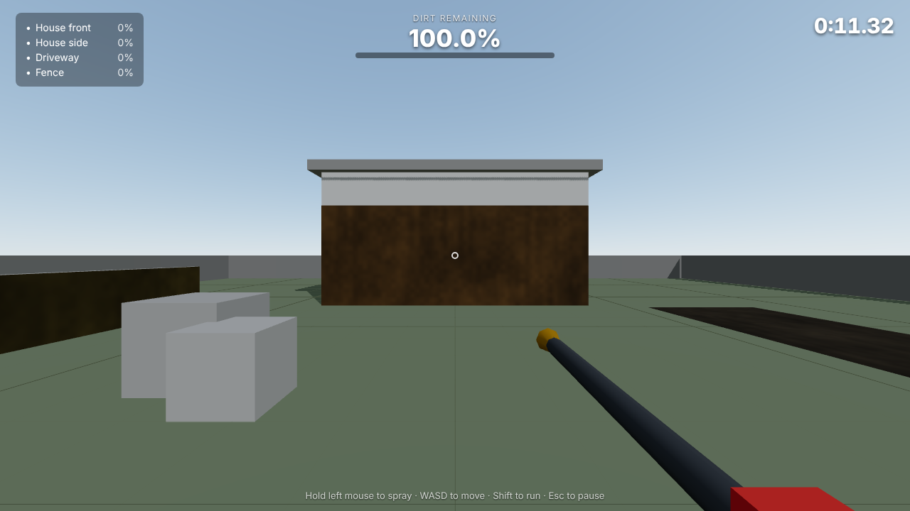
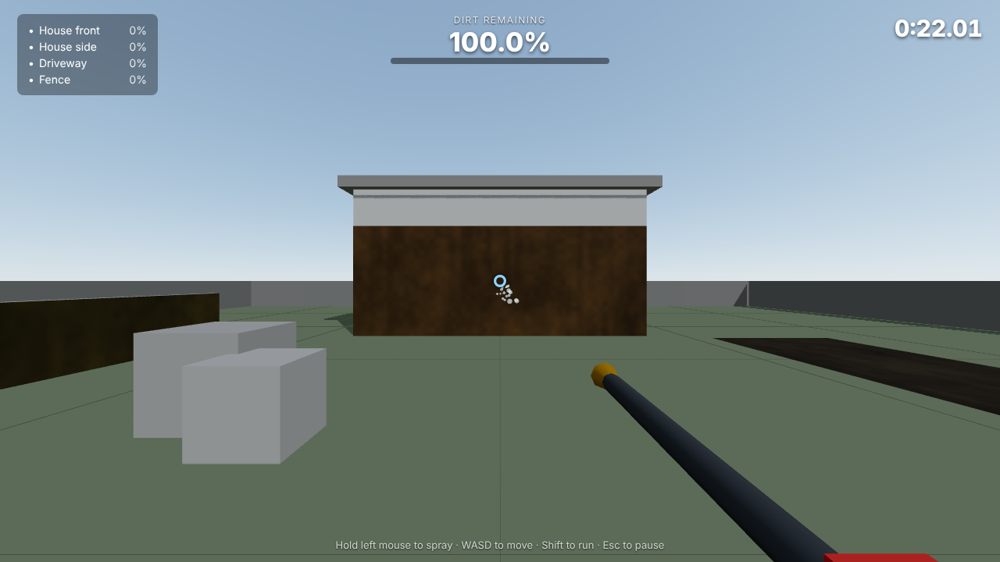
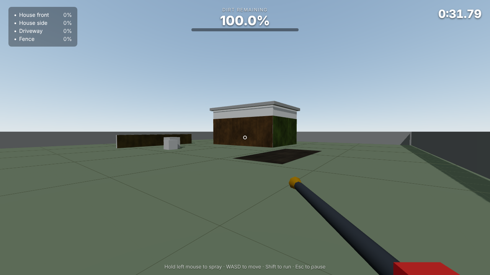
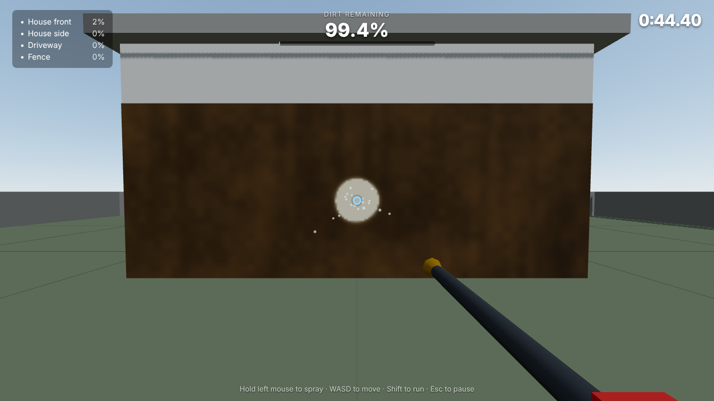
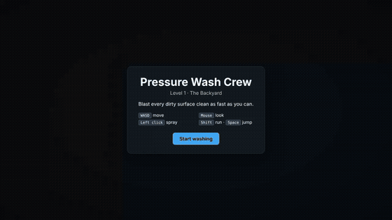

## Screenshots

| View | Before | After |
| --- | --- | --- |
| `menu` |  |  |
| `spawn` |  |  |
| `spawn-spraying` |  |  |
| `yard-overview` | _build has no debug API (pose)_ |  |
| `house-closeup-spraying` | _build has no debug API (pose)_ |  |

## Video walkthrough

Full video (after): [walkthrough.mp4](./after/walkthrough.mp4)

## Metrics

Target: **120 FPS = 8.33 ms/frame**. Frame time is the interval between frames with vsync off (real throughput); CPU is time spent in requestAnimationFrame callbacks (game logic + three.js draw submission); draw calls and triangles cover every pass, including the shadow map.

- Renderer: `ANGLE (Google, Vulkan 1.3.0 (SwiftShader Device (Subzero) (0x0000C0DE)), SwiftShader driver)` (headless), 1280×720, 4s sample per view
- Before: `ff08c55` · After: `ff08c55`
- ⚠️ **Software GPU** (SwiftShader). Absolute FPS here is far below real hardware, so the 120 FPS column only checks CPU time per frame; judge by the before → after deltas, and re-run with `--headed` on a machine with a GPU for absolute numbers.

| View | Frame ms median (before → after) | Frame ms p95 | FPS | CPU ms median | Draw calls | Triangles | 120 FPS |
| --- | --- | --- | --- | --- | --- | --- | --- |
| `menu` | 141.20 → 132.20 (-6.4%) | 169.00 → 152.90 (-9.5%) | 7.1 → 7.5 (+5.9%) | 1.30 → 1.20 (-7.7%) | 29 → 29 (+0.0%) | 25,516 → 25,516 (+0.0%) | GPU n/a · CPU ✅ |
| `spawn` | 130.60 → 132.00 (+1.1%) | 148.50 → 154.20 (+3.8%) | 7.5 → 7.5 (-0.7%) | 1.00 → 1.10 (+10.0%) | 29 → 29 (+0.0%) | 25,516 → 25,516 (+0.0%) | GPU n/a · CPU ✅ |
| `spawn-spraying` | 129.80 → 130.60 (+0.6%) | 148.60 → 151.40 (+1.9%) | 7.7 → 7.8 (+0.9%) | 1.20 → 1.10 (-8.3%) | 29 → 29 (+0.0%) | 25,516 → 25,516 (+0.0%) | GPU n/a · CPU ✅ |
| `yard-overview` | 122.80 (new) | 149.50 (new) | 8.1 (new) | 1.00 (new) | 29 (new) | 25,516 (new) | GPU n/a · CPU ✅ |
| `house-closeup-spraying` | 162.20 (new) | 199.90 (new) | 6.1 (new) | 1.40 (new) | 25 (new) | 25,478 (new) | GPU n/a · CPU ✅ |

Thresholds for the suggested risk: frame time +25% / triangles or draw calls +25% ⇒ High; +10% / +5% ⇒ Medium. Frame-time bands are wider on a software GPU (±10% run-to-run noise is normal there).

<!-- suggested-risk: Low -->
