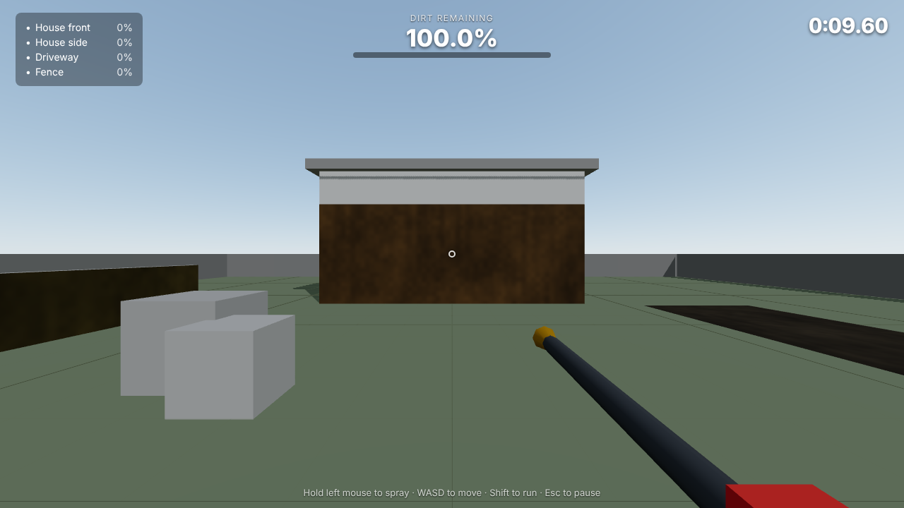
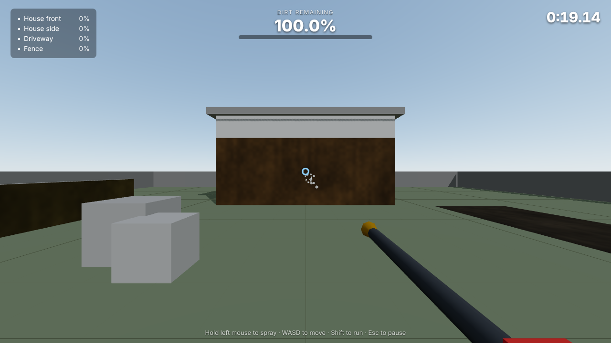
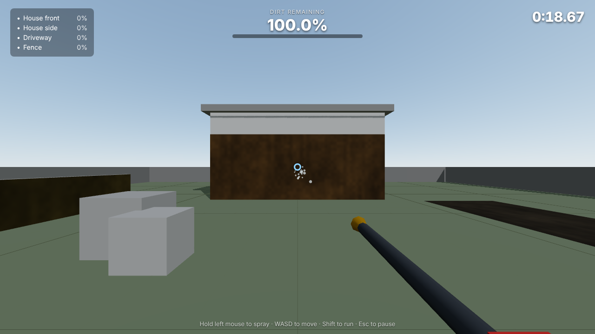
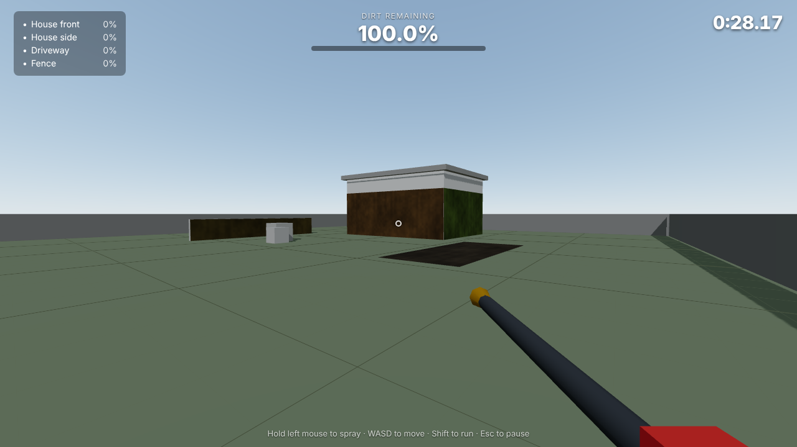
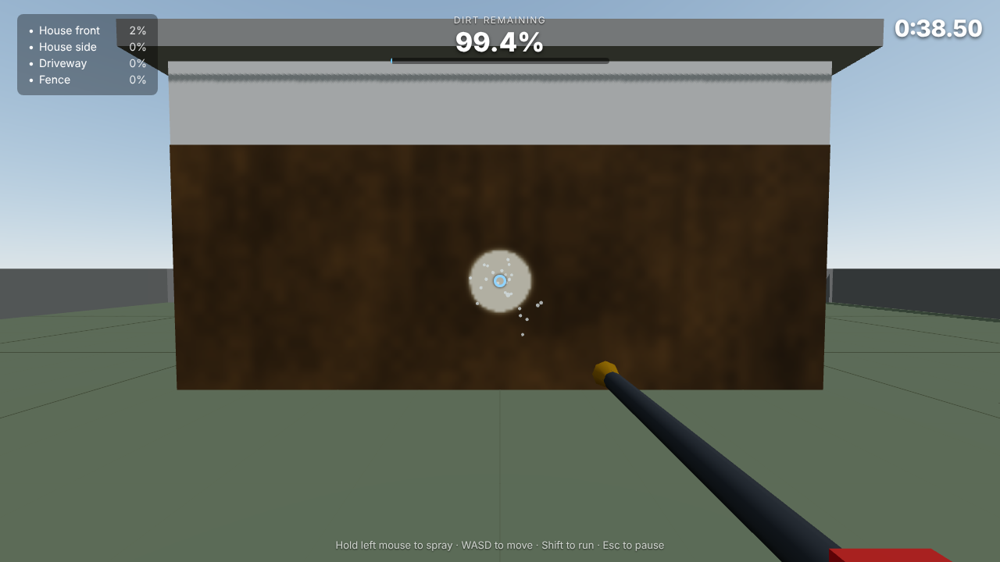
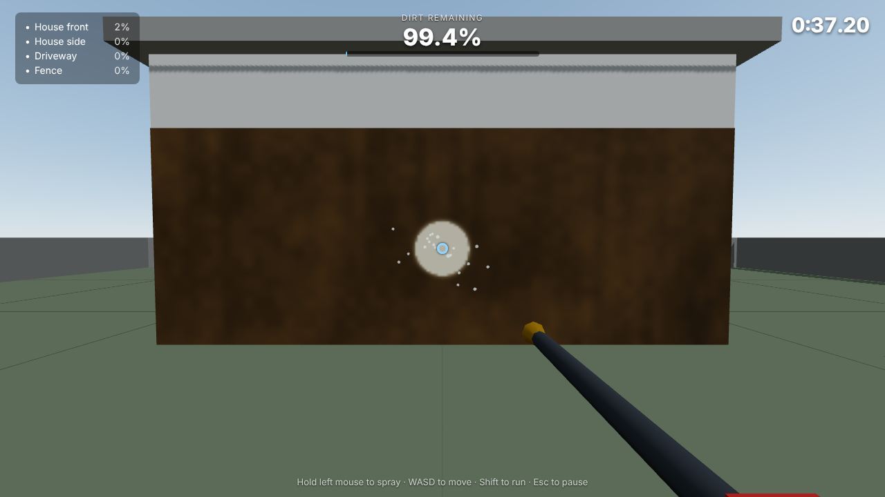
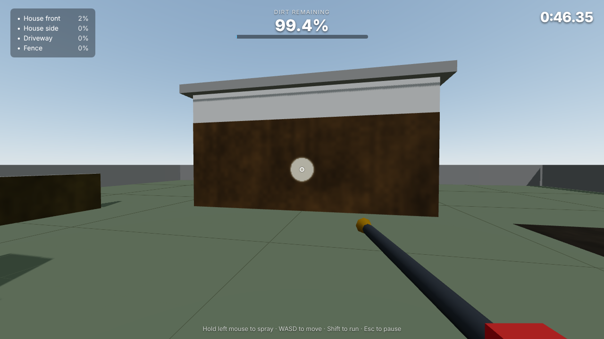
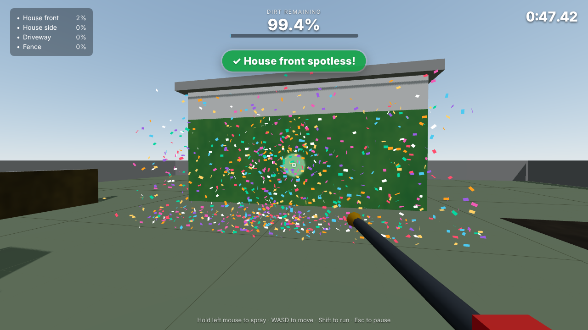
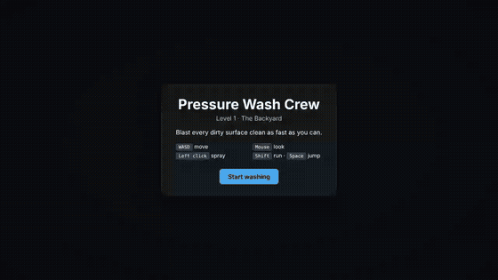

## Screenshots

| View | Before | After |
| --- | --- | --- |
| `menu` |  |  |
| `spawn` |  |  |
| `spawn-spraying` |  |  |
| `yard-overview` |  |  |
| `house-closeup-spraying` |  |  |
| `wall-celebration` |  |  |

## Video walkthrough

Full video (after): [walkthrough.mp4](./after/walkthrough.mp4)

## Metrics

Target: **120 FPS = 8.33 ms/frame**. Frame time is the interval between frames with vsync off (real throughput); CPU is time spent in requestAnimationFrame callbacks (game logic + three.js draw submission); draw calls and triangles cover every pass, including the shadow map.

- Renderer: `ANGLE (Google, Vulkan 1.3.0 (SwiftShader Device (Subzero) (0x0000C0DE)), SwiftShader driver)` (headless), 1280×720, 4s sample per view
- Before: `d879b16` · After: `8f006e9`
- ⚠️ **Software GPU** (SwiftShader). Absolute FPS here is far below real hardware, so the 120 FPS column only checks CPU time per frame; judge by the before → after deltas, and re-run with `--headed` on a machine with a GPU for absolute numbers.

| View | Frame ms median (before → after) | Frame ms p95 | FPS | CPU ms median | Draw calls | Triangles | 120 FPS |
| --- | --- | --- | --- | --- | --- | --- | --- |
| `menu` | 108.00 → 112.10 (+3.8%) | 123.70 → 129.60 (+4.8%) | 9.2 → 8.9 (-3.2%) | 1.20 → 1.20 (+0.0%) | 29 → 29 (+0.0%) | 25,516 → 25,516 (+0.0%) | GPU n/a · CPU ✅ |
| `spawn` | 117.30 → 105.70 (-9.9%) | 138.60 → 122.60 (-11.5%) | 8.4 → 9.5 (+13.2%) | 1.20 → 1.10 (-8.3%) | 29 → 29 (+0.0%) | 25,516 → 25,516 (+0.0%) | GPU n/a · CPU ✅ |
| `spawn-spraying` | 107.90 → 110.90 (+2.8%) | 122.40 → 136.30 (+11.4%) | 9.4 → 9.1 (-3.3%) | 1.10 → 1.20 (+9.1%) | 29 → 29 (+0.0%) | 25,516 → 25,516 (+0.0%) | GPU n/a · CPU ✅ |
| `yard-overview` | 106.50 → 96.60 (-9.3%) | 121.10 → 120.00 (-0.9%) | 9.4 → 10.1 (+7.5%) | 1.00 → 0.90 (-10.0%) | 29 → 29 (+0.0%) | 25,516 → 25,516 (+0.0%) | GPU n/a · CPU ✅ |
| `house-closeup-spraying` | 133.30 → 123.30 (-7.5%) | 159.50 → 138.30 (-13.3%) | 7.5 → 8.1 (+7.9%) | 1.20 → 1.20 (-0.0%) | 25 → 25 (+0.0%) | 25,478 → 25,478 (+0.0%) | GPU n/a · CPU ✅ |
| `wall-celebration` | 92.90 → 128.10 (+37.9%) | 104.10 → 152.40 (+46.4%) | 10.9 → 7.8 (-29.0%) | 0.80 → 1.30 (+62.5%) | 27 → 30 (+11.1%) | 25,492 → 27,496 (+7.9%) | GPU n/a · CPU ✅ |

Thresholds for the suggested risk: frame time +25% / triangles or draw calls +25% ⇒ High; +10% / +5% ⇒ Medium. Frame-time bands are wider on a software GPU (±10% run-to-run noise is normal there).

<!-- suggested-risk: High (`wall-celebration` frame time +37.9%; `wall-celebration` triangles +7.9%; `wall-celebration` draw calls +11.1%) -->
