## Screenshots

| View | Before | After |
| --- | --- | --- |
| `menu` |  | 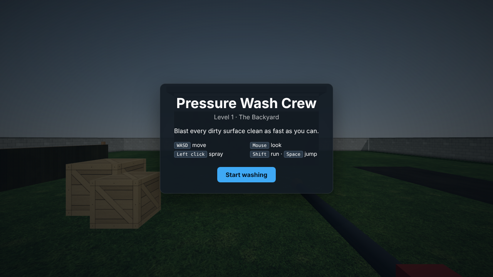 |
| `spawn` | 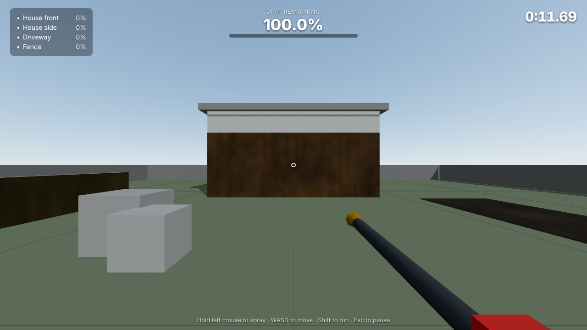 | 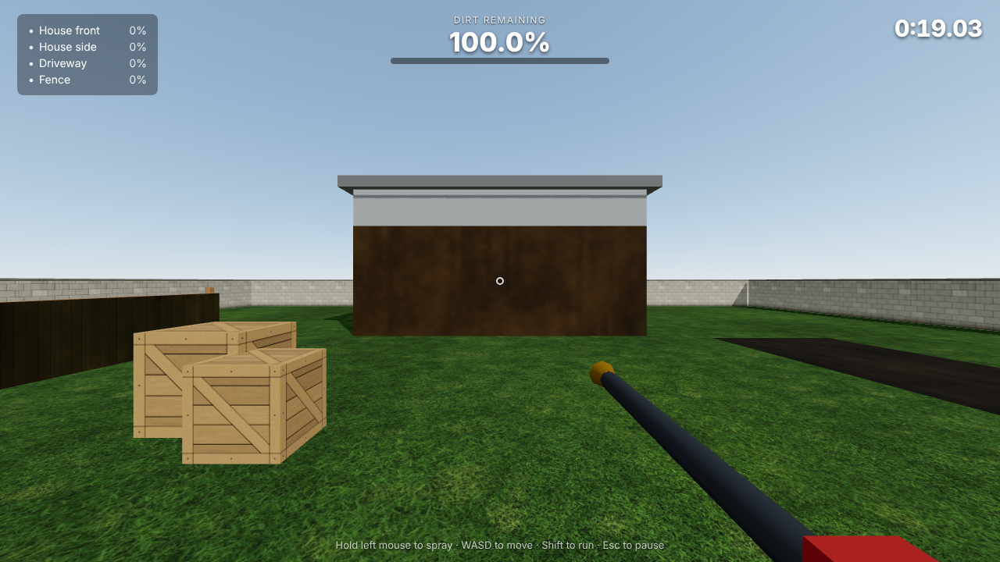 |
| `spawn-spraying` | 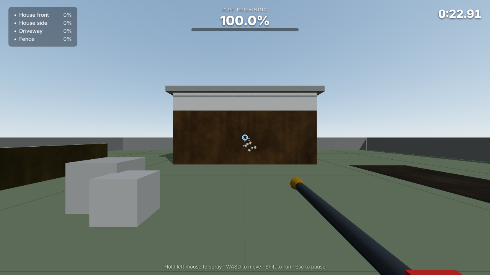 |  |
| `yard-overview` | 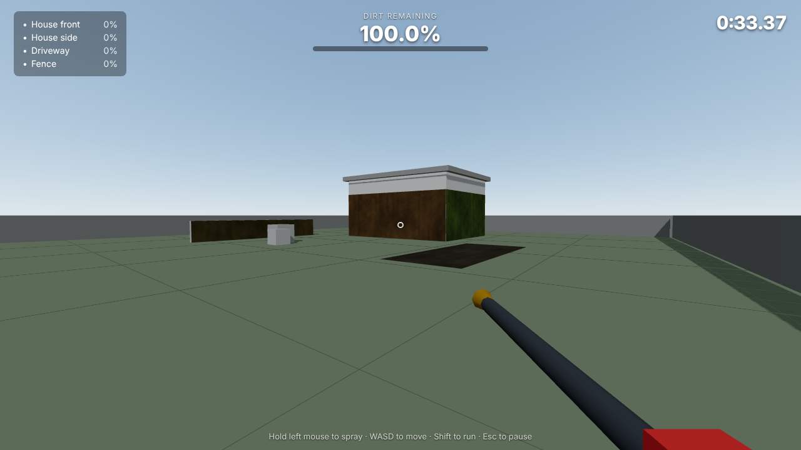 | 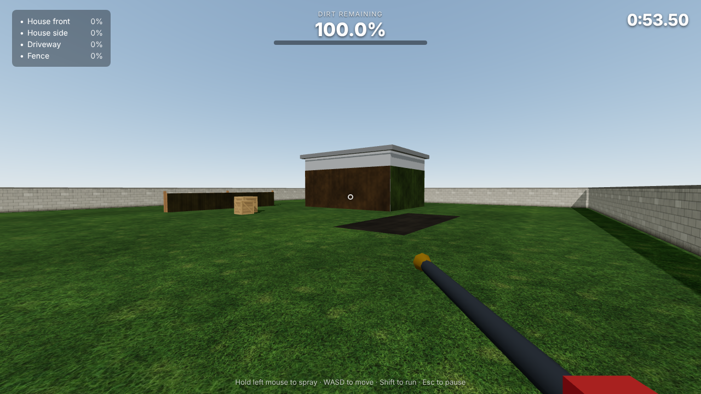 |
| `house-closeup-spraying` | 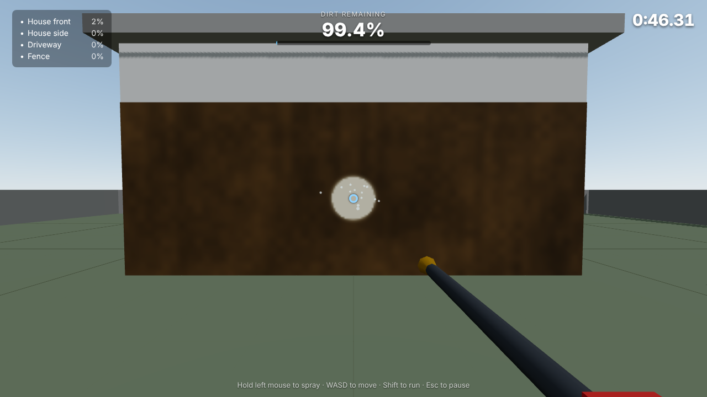 | 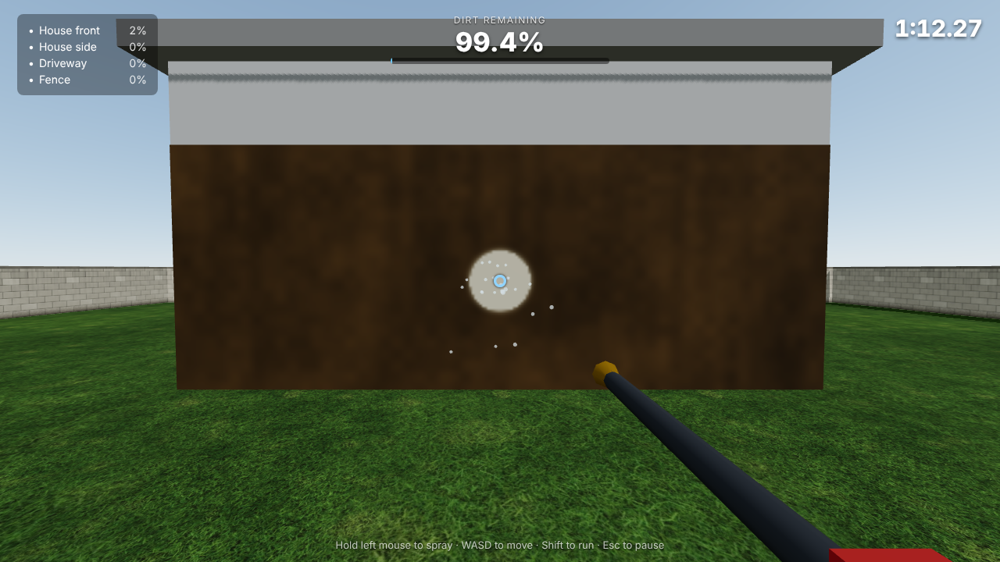 |
| `driveway-spraying` | 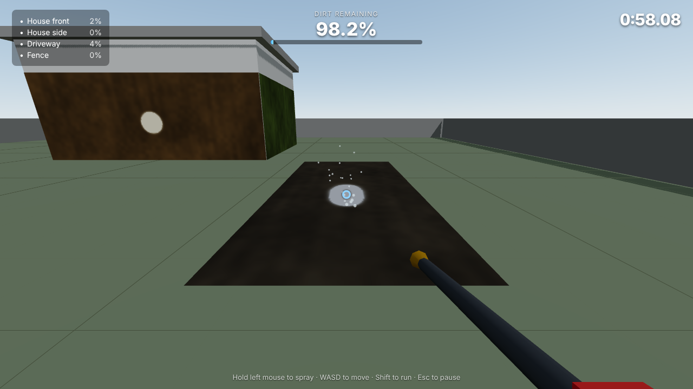 | 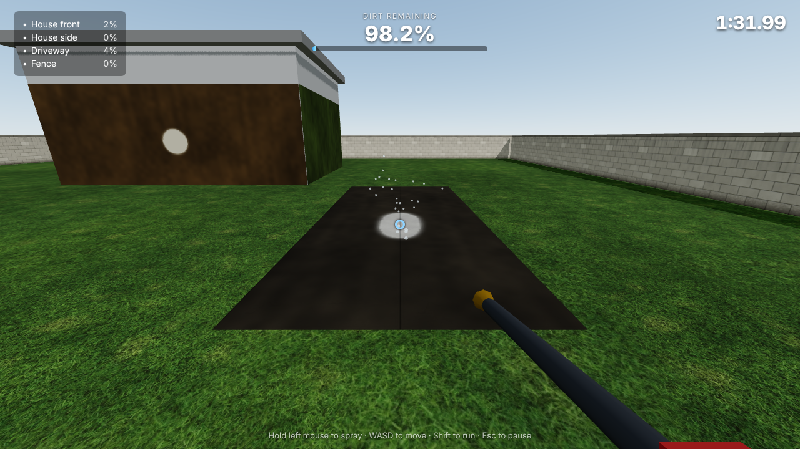 |
| `fence-closeup` | 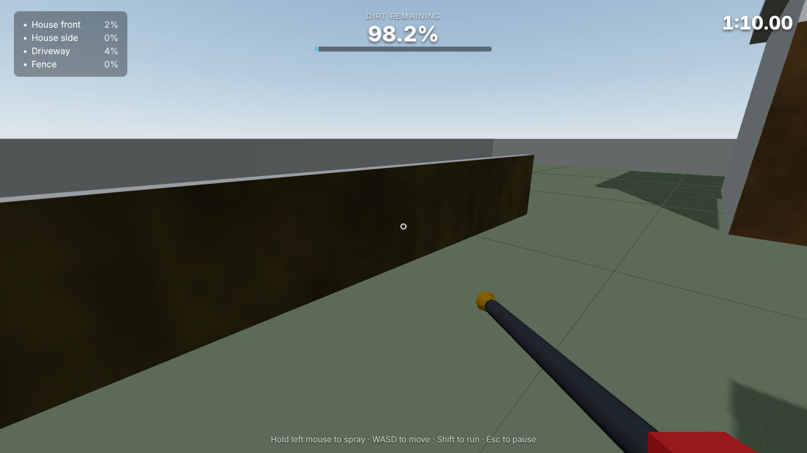 | 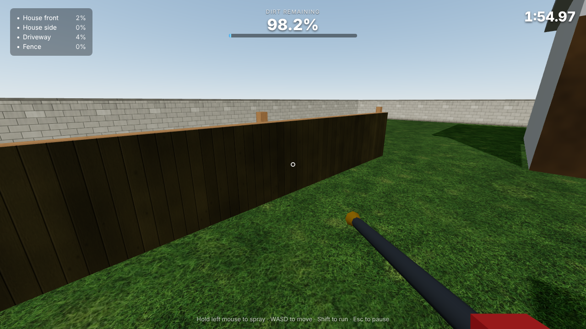 |
| `perimeter-wall` | 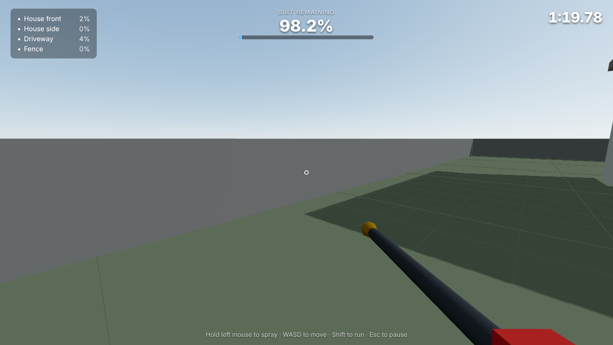 | 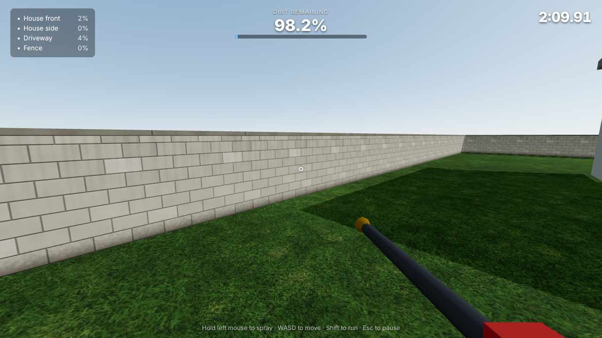 |

## Video walkthrough

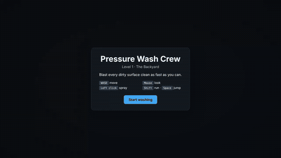
Full video (after): [walkthrough.mp4](./after/walkthrough.mp4)

## Metrics

Target: **120 FPS = 8.33 ms/frame**. Frame time is the interval between frames with vsync off (real throughput); CPU is time spent in requestAnimationFrame callbacks (game logic + three.js draw submission); draw calls and triangles cover every pass, including the shadow map.

- Renderer: `ANGLE (Google, Vulkan 1.3.0 (SwiftShader Device (Subzero) (0x0000C0DE)), SwiftShader driver)` (headless), 1280×720, 4s sample per view
- Before: `d879b16` · After: `c4fa194 + uncommitted changes`
- ⚠️ **Software GPU** (SwiftShader). Absolute FPS here is far below real hardware, so the 120 FPS column only checks CPU time per frame; judge by the before → after deltas, and re-run with `--headed` on a machine with a GPU for absolute numbers.

| View | Frame ms median (before → after) | Frame ms p95 | FPS | CPU ms median | Draw calls | Triangles | 120 FPS |
| --- | --- | --- | --- | --- | --- | --- | --- |
| `menu` | 140.10 → 236.40 (+68.7%) | 159.50 → 280.50 (+75.9%) | 7.2 → 4.2 (-41.7%) | 1.30 → 1.80 (+38.5%) | 29 → 22 (-24.1%) | 25,516 → 25,730 (+0.8%) | GPU n/a · CPU ✅ |
| `spawn` | 133.80 → 242.90 (+81.5%) | 167.50 → 271.50 (+62.1%) | 7.2 → 4.1 (-42.6%) | 1.10 → 1.50 (+36.4%) | 29 → 22 (-24.1%) | 25,516 → 25,730 (+0.8%) | GPU n/a · CPU ✅ |
| `spawn-spraying` | 139.10 → 231.30 (+66.3%) | 165.20 → 276.60 (+67.4%) | 7.3 → 4.3 (-41.1%) | 1.20 → 1.50 (+25.0%) | 29 → 22 (-24.1%) | 25,516 → 25,730 (+0.8%) | GPU n/a · CPU ✅ |
| `yard-overview` | 127.00 → 205.00 (+61.4%) | 146.70 → 232.10 (+58.2%) | 7.8 → 4.8 (-38.1%) | 1.10 → 1.30 (+18.2%) | 29 → 22 (-24.1%) | 25,516 → 25,730 (+0.8%) | GPU n/a · CPU ✅ |
| `house-closeup-spraying` | 163.40 → 242.30 (+48.3%) | 204.50 → 278.40 (+36.1%) | 6.0 → 4.1 (-31.5%) | 1.40 → 1.60 (+14.3%) | 25 → 19 (-24.0%) | 25,478 → 25,632 (+0.6%) | GPU n/a · CPU ✅ |
| `driveway-spraying` | 146.50 → 254.20 (+73.5%) | 171.70 → 299.80 (+74.6%) | 6.8 → 3.9 (-42.8%) | 1.10 → 1.50 (+36.4%) | 25 → 19 (-24.0%) | 25,478 → 25,632 (+0.6%) | GPU n/a · CPU ✅ |
| `fence-closeup` | 147.30 → 302.20 (+105.2%) | 173.00 → 347.20 (+100.7%) | 6.7 → 3.3 (-50.8%) | 1.00 → 1.40 (+40.0%) | 24 → 19 (-20.8%) | 25,476 → 25,702 (+0.9%) | GPU n/a · CPU ✅ |
| `perimeter-wall` | 114.90 → 183.70 (+59.9%) | 139.00 → 209.40 (+50.6%) | 8.7 → 5.4 (-37.6%) | 0.90 → 1.10 (+22.2%) | 22 → 17 (-22.7%) | 25,462 → 25,628 (+0.7%) | GPU n/a · CPU ✅ |

Thresholds for the suggested risk: frame time +25% / triangles or draw calls +25% ⇒ High; +10% / +5% ⇒ Medium. Frame-time bands are wider on a software GPU (±10% run-to-run noise is normal there).

<!-- suggested-risk: High (`menu` frame time +68.7%; `spawn` frame time +81.5%; `spawn-spraying` frame time +66.3%; `yard-overview` frame time +61.4%; `house-closeup-spraying` frame time +48.3%; `driveway-spraying` frame time +73.5%; `fence-closeup` frame time +105.2%; `perimeter-wall` frame time +59.9%) -->
