## Screenshots

| View | Before | After |
| --- | --- | --- |
| `menu` | 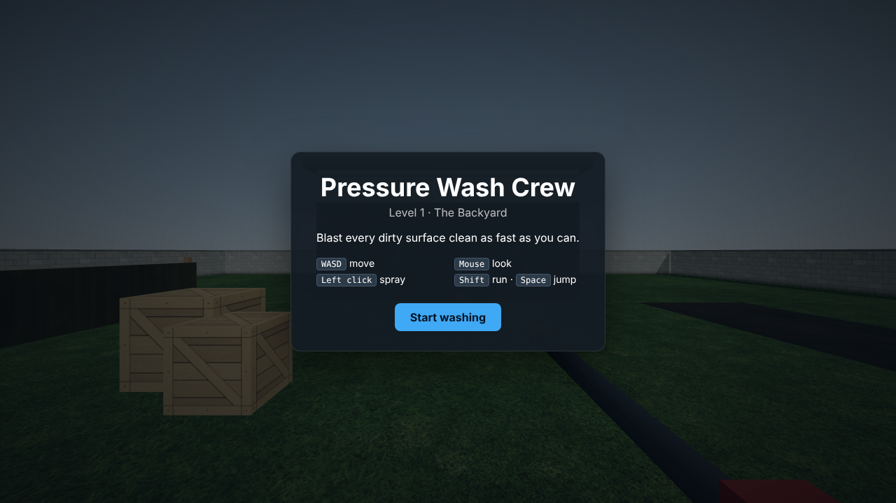 |  |
| `spawn` | 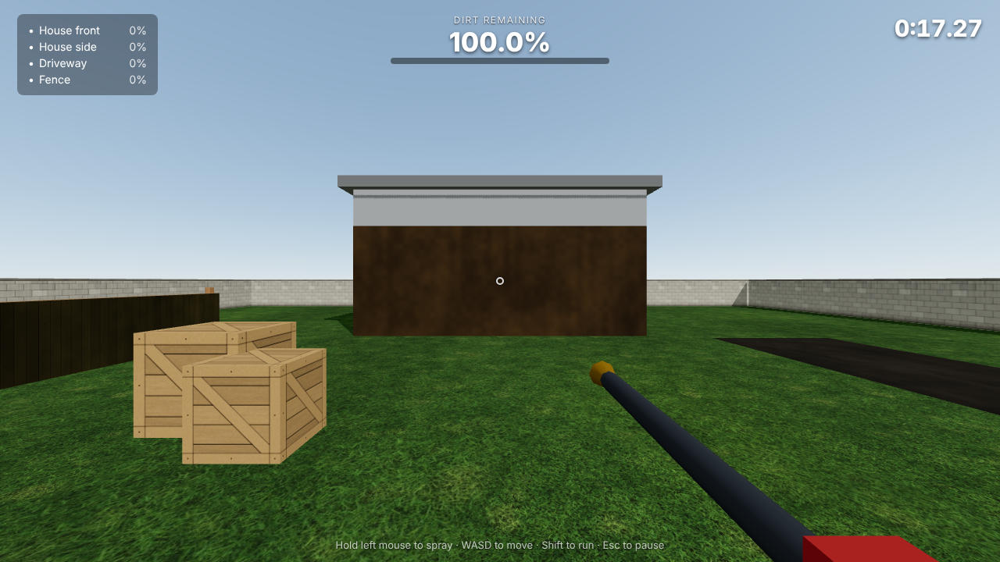 | 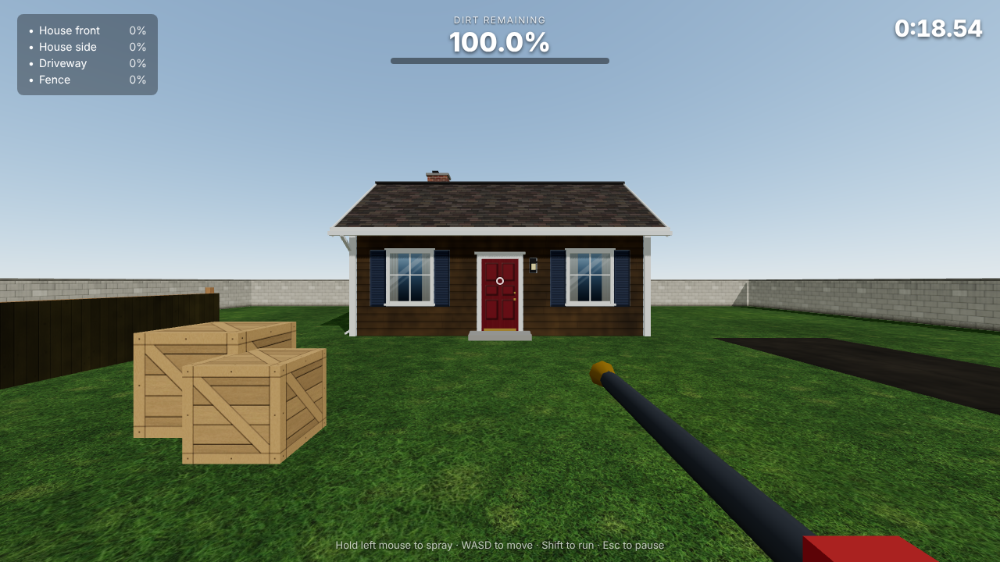 |
| `spawn-spraying` |  | 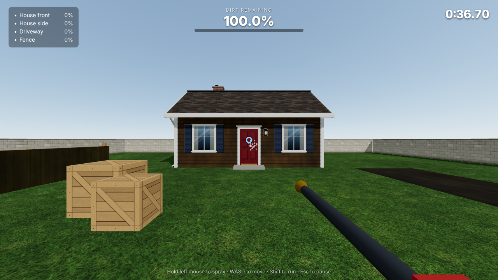 |
| `yard-overview` | 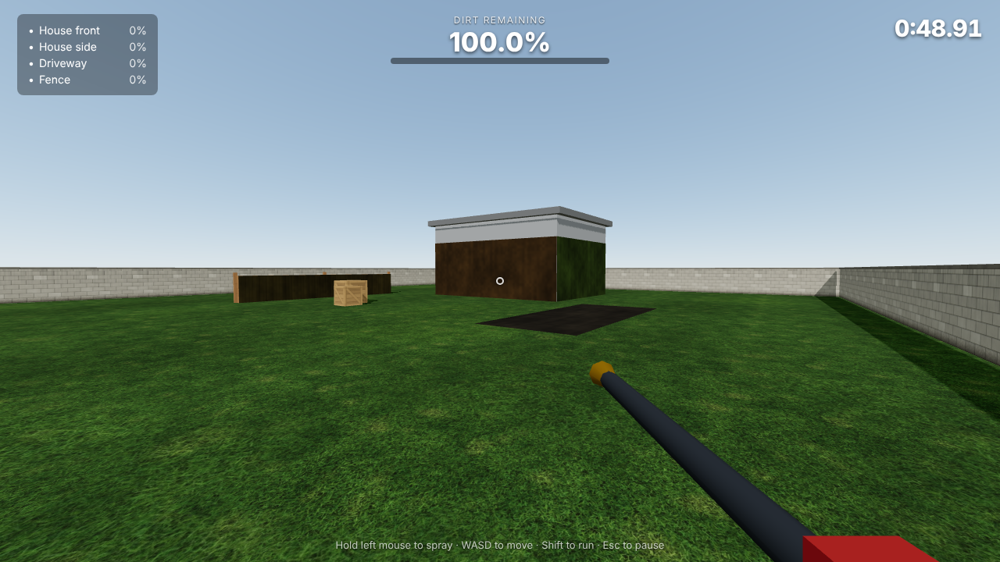 | 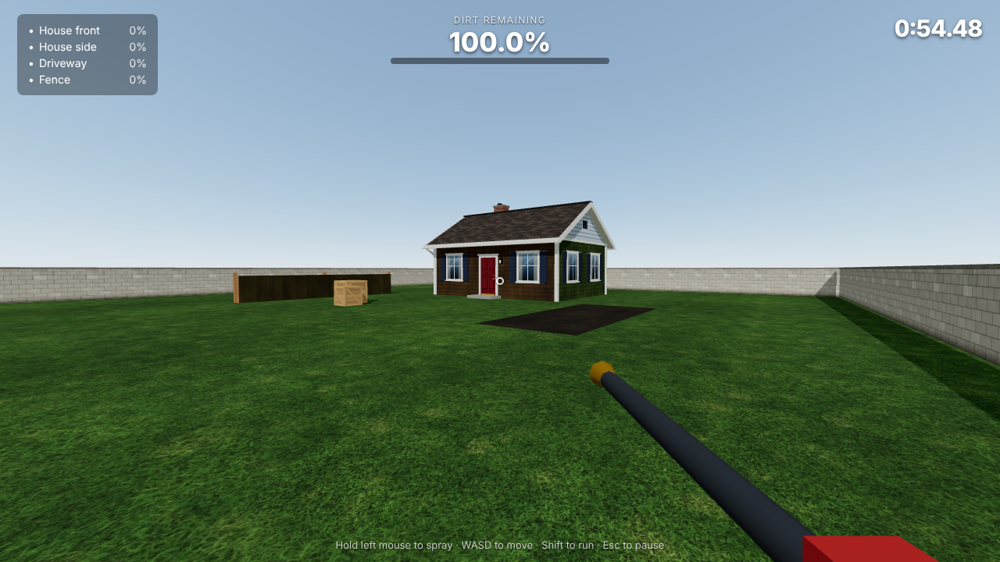 |
| `house-closeup-spraying` | 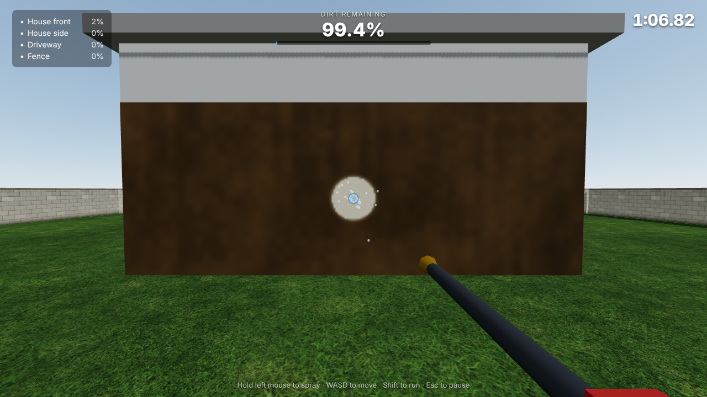 | 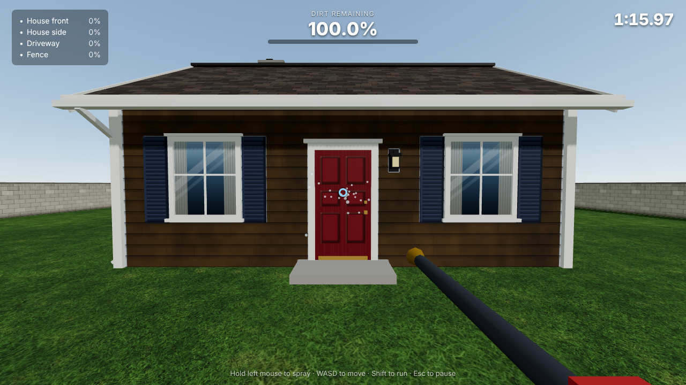 |
| `house-corner` | 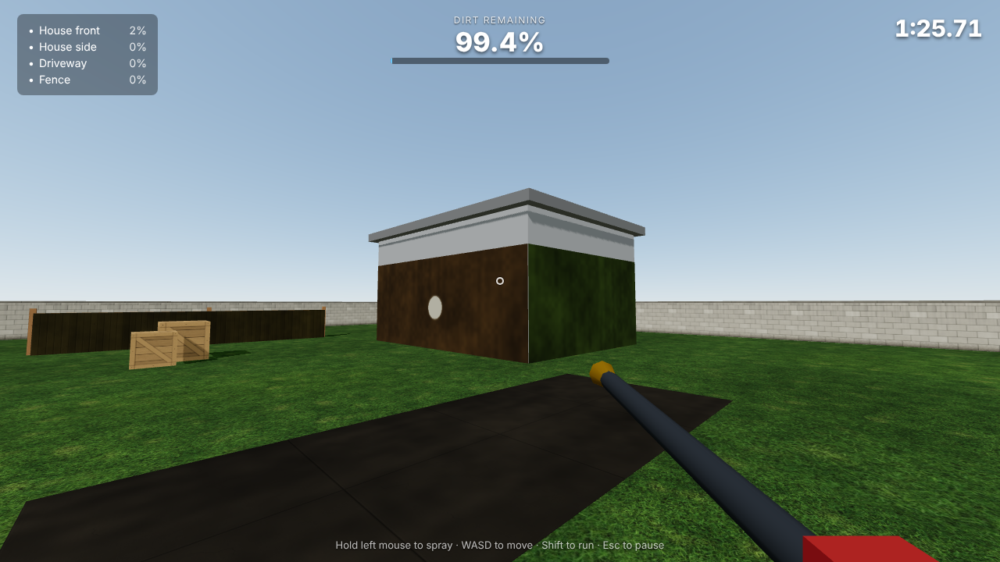 | 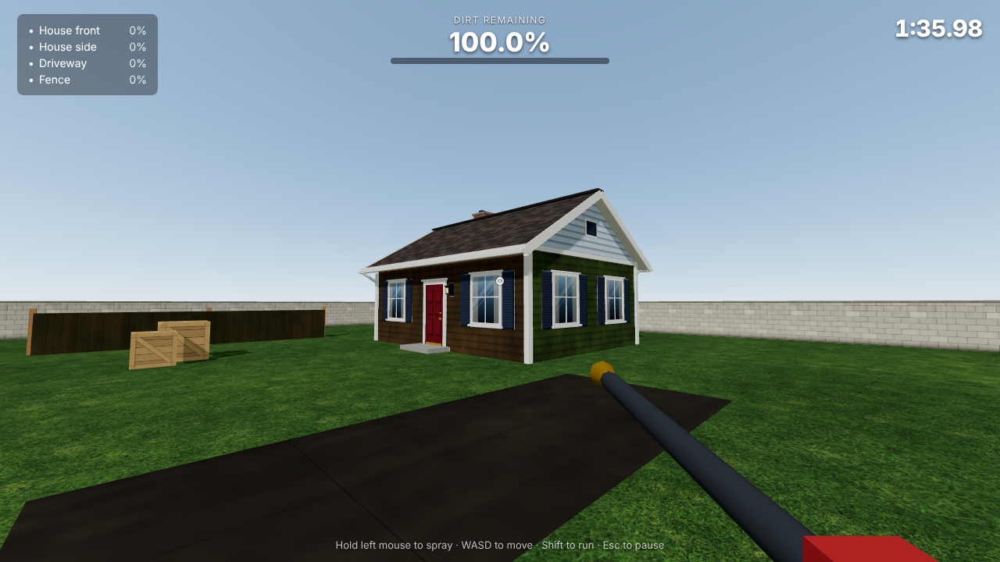 |
| `house-door-spraying` | 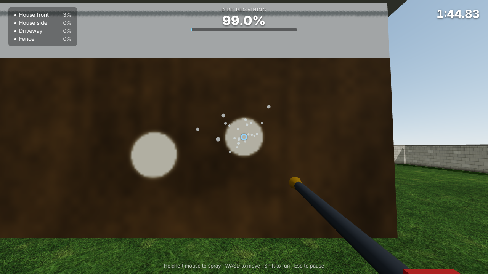 | 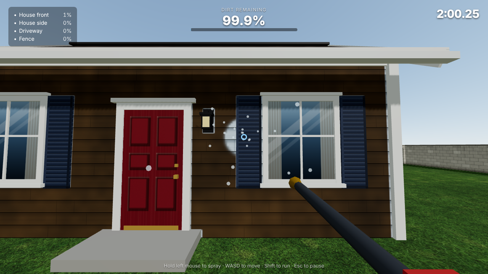 |

## Video walkthrough

Full video (after): [walkthrough.mp4](./after/walkthrough.mp4)

## Metrics

Target: **120 FPS = 8.33 ms/frame**. Frame time is the interval between frames with vsync off (real throughput); CPU is time spent in requestAnimationFrame callbacks (game logic + three.js draw submission); draw calls and triangles cover every pass, including the shadow map.

- Renderer: `ANGLE (Google, Vulkan 1.3.0 (SwiftShader Device (Subzero) (0x0000C0DE)), SwiftShader driver)` (headless), 1280×720, 4s sample per view
- Before: `c4fa194` · After: `73a27d5`
- ⚠️ **Software GPU** (SwiftShader). Absolute FPS here is far below real hardware, so the 120 FPS column only checks CPU time per frame; judge by the before → after deltas, and re-run with `--headed` on a machine with a GPU for absolute numbers.

| View | Frame ms median (before → after) | Frame ms p95 | FPS | CPU ms median | Draw calls | Triangles | 120 FPS |
| --- | --- | --- | --- | --- | --- | --- | --- |
| `menu` | 213.50 → 234.20 (+9.7%) | 253.00 → 283.90 (+12.2%) | 4.6 → 4.2 (-8.6%) | 1.70 → 1.90 (+11.8%) | 45 → 53 (+17.8%) | 25,718 → 28,468 (+10.7%) | GPU n/a · CPU ✅ |
| `spawn` | 216.30 → 236.20 (+9.2%) | 248.20 → 288.10 (+16.1%) | 4.6 → 4.2 (-9.0%) | 1.30 → 1.50 (+15.4%) | 45 → 53 (+17.8%) | 25,718 → 28,468 (+10.7%) | GPU n/a · CPU ✅ |
| `spawn-spraying` | 211.30 → 238.40 (+12.8%) | 249.90 → 275.10 (+10.1%) | 4.7 → 4.2 (-11.4%) | 1.50 → 1.70 (+13.3%) | 45 → 53 (+17.8%) | 25,718 → 28,468 (+10.7%) | GPU n/a · CPU ✅ |
| `yard-overview` | 196.90 → 229.10 (+16.4%) | 230.80 → 263.80 (+14.3%) | 5.1 → 4.3 (-14.7%) | 1.40 → 1.50 (+7.1%) | 46 → 54 (+17.4%) | 25,730 → 28,480 (+10.7%) | GPU n/a · CPU ✅ |
| `house-closeup-spraying` | 233.10 → 289.30 (+24.1%) | 266.20 → 338.40 (+27.1%) | 4.3 → 3.4 (-19.7%) | 1.80 → 1.60 (-11.1%) | 37 → 45 (+21.6%) | 25,632 → 28,382 (+10.7%) | GPU n/a · CPU ✅ |
| `house-corner` | 249.80 → 250.40 (+0.2%) | 289.70 → 290.70 (+0.3%) | 4.0 → 3.9 (-2.9%) | 1.50 → 1.60 (+6.7%) | 46 → 54 (+17.4%) | 25,730 → 28,480 (+10.7%) | GPU n/a · CPU ✅ |
| `house-door-spraying` | 241.30 → 336.00 (+39.2%) | 299.90 → 390.30 (+30.1%) | 4.0 → 3.0 (-26.1%) | 1.60 → 2.00 (+25.0%) | 35 → 43 (+22.9%) | 25,618 → 28,368 (+10.7%) | GPU n/a · CPU ✅ |

Thresholds for the suggested risk: frame time +25% / triangles or draw calls +25% ⇒ High; +10% / +5% ⇒ Medium. Frame-time bands are wider on a software GPU (±10% run-to-run noise is normal there).

<!-- suggested-risk: High (`menu` triangles +10.7%; `menu` draw calls +17.8%; `spawn` triangles +10.7%; `spawn` draw calls +17.8%; `spawn-spraying` frame time +12.8%; `spawn-spraying` triangles +10.7%; `spawn-spraying` draw calls +17.8%; `yard-overview` frame time +16.4%; `yard-overview` triangles +10.7%; `yard-overview` draw calls +17.4%; `house-closeup-spraying` frame time +24.1%; `house-closeup-spraying` triangles +10.7%; `house-closeup-spraying` draw calls +21.6%; `house-corner` triangles +10.7%; `house-corner` draw calls +17.4%; `house-door-spraying` frame time +39.2%; `house-door-spraying` triangles +10.7%; `house-door-spraying` draw calls +22.9%) -->
