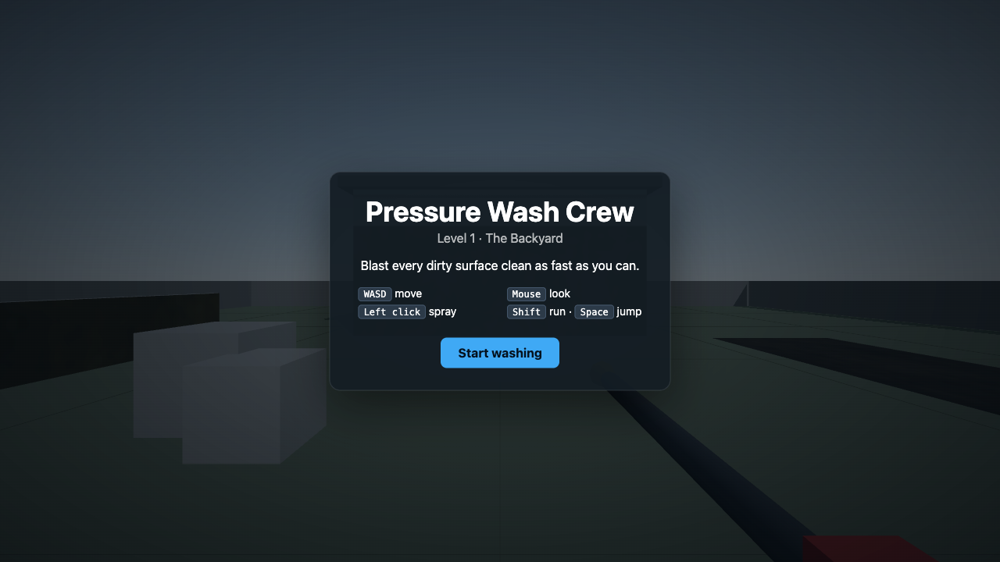
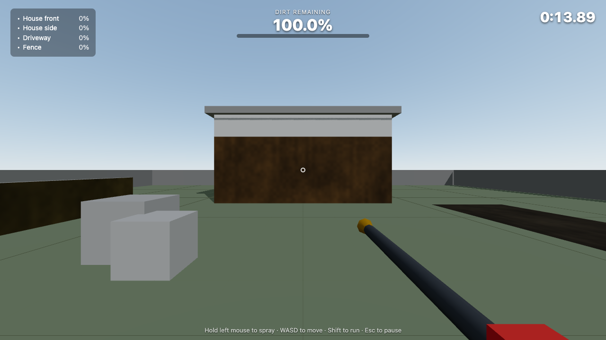
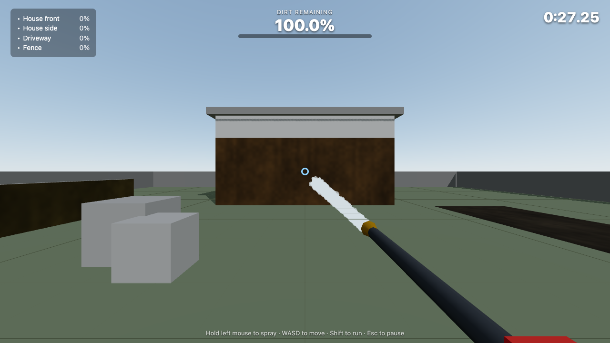
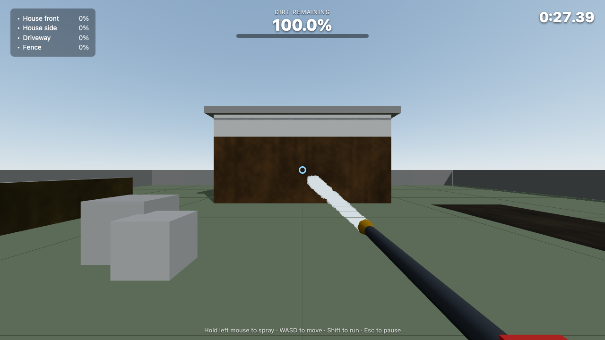
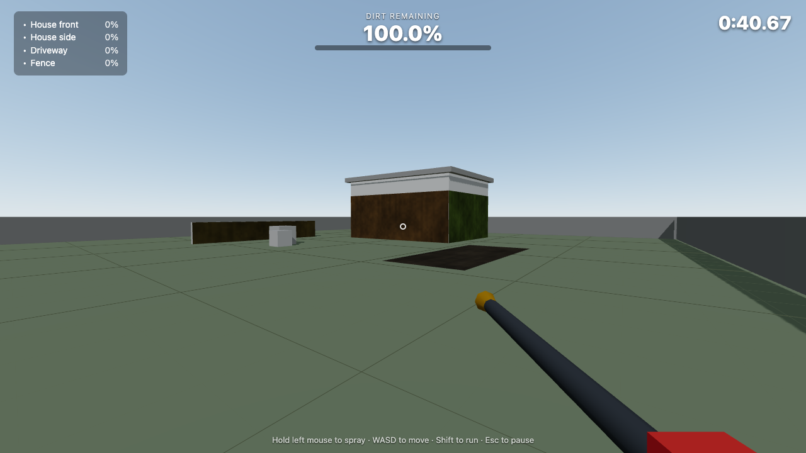
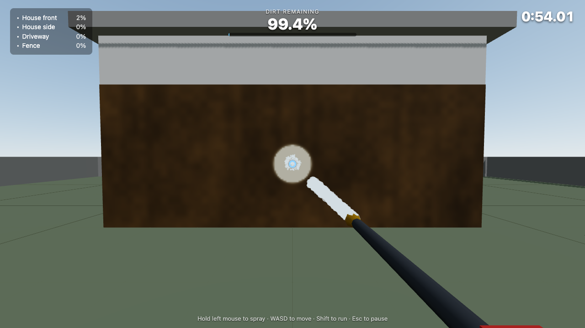
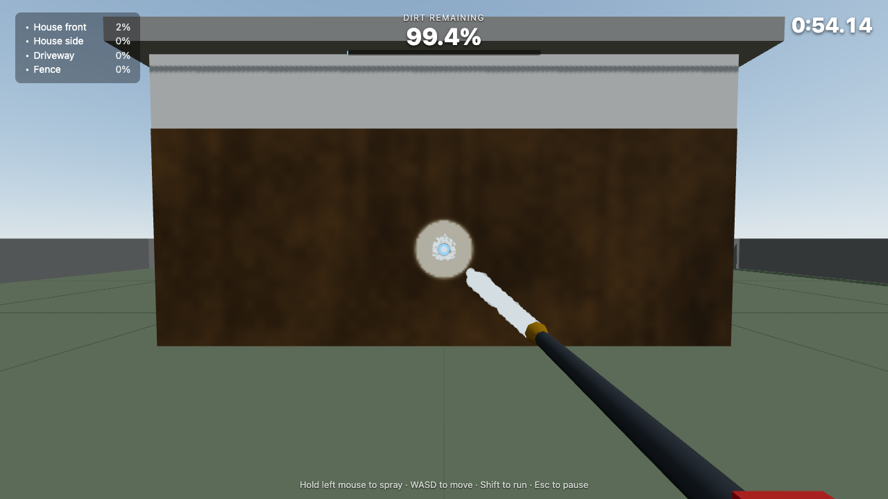

## Screenshots

| View | Before | After |
| --- | --- | --- |
| `menu` |  |  |
| `spawn` |  |  |
| `spawn-spraying` |  |  |
| `yard-overview` |  |  |
| `house-closeup-spraying` |  |  |

## Video walkthrough

Full video (after): [walkthrough.mp4](./after/walkthrough.mp4)

## Metrics

Target: **120 FPS = 8.33 ms/frame**. Frame time is the interval between frames with vsync off (real throughput); CPU is time spent in requestAnimationFrame callbacks (game logic + three.js draw submission); draw calls and triangles cover every pass, including the shadow map.

- Renderer: `ANGLE (Apple, ANGLE Metal Renderer: Apple M3 Pro, Unspecified Version)` (headed), chrome 158.0.8127.37, 1280×720, 4s × 3 sample(s) per view
- Before: `d879b16` · After: `d879b16 + uncommitted changes`

| View | Frame ms median (before → after) | Frame ms p95 | FPS | CPU ms median | Draw calls | Triangles | 120 FPS |
| --- | --- | --- | --- | --- | --- | --- | --- |
| `menu` | 2.20 → 2.20 (-0.0%) | 2.50 → 2.50 (+0.0%) | 714.2 → 726.5 (+1.7%) | 2.10 → 2.10 (+0.0%) | 29 → 29 (+0.0%) | 25,516 → 25,516 (+0.0%) | ✅ |
| `spawn` | 1.90 → 2.00 (+5.3%) | 2.50 → 2.50 (+0.0%) | 741.6 → 754.6 (+1.7%) | 1.90 → 1.90 (+0.0%) | 29 → 29 (+0.0%) | 25,516 → 25,516 (+0.0%) | ✅ |
| `spawn-spraying` | 1.90 → 1.90 (+0.0%) | 2.50 → 2.50 (+0.0%) | 765.8 → 770.6 (+0.6%) | 1.90 → 1.90 (+0.0%) | 29 → 29 (+0.0%) | 25,516 → 25,516 (+0.0%) | ✅ |
| `yard-overview` | 2.00 → 2.00 (+0.0%) | 2.50 → 2.50 (+0.0%) | 754.0 → 740.8 (-1.8%) | 2.00 → 1.90 (-5.0%) | 29 → 29 (+0.0%) | 25,516 → 25,516 (+0.0%) | ✅ |
| `house-closeup-spraying` | 0.80 → 0.80 (+0.0%) | 1.20 → 1.20 (+0.0%) | 1230.2 → 1187.3 (-3.5%) | 0.70 → 0.70 (+0.0%) | 25 → 25 (+0.0%) | 25,478 → 25,478 (+0.0%) | ✅ |

Suggested-risk thresholds: triangles or draw calls +25% ⇒ High, +5% ⇒ Medium. Frame and CPU time (mean, real GPU): +0.83 ms (10% of the budget) or +50% ⇒ High, +0.25 ms and +10% ⇒ Medium; dropping under 120 FPS ⇒ High.

### Against the main baseline

- Baseline: `d879b16` recorded 2026-11-24 on MacBook Pro (Mac15,6), Apple M3 Pro: `ANGLE (Apple, ANGLE Metal Renderer: Apple M3 Pro, Unspecified Version)` (headed), chrome 158.0.8127.37, 1280×720, 3 runs × 3 samples, vsync off.

| View | FPS (baseline → after) | Frame ms mean | Frame ms p95 | CPU ms mean | Draw calls | Triangles | vs baseline |
| --- | --- | --- | --- | --- | --- | --- | --- |
| `menu` | 727.4 → 726.5 (-0.1%) | 1.37 → 1.38 (+0.1%) | 2.50 → 2.50 (+0.0%) | 1.33 → 1.31 (-1.5%) | 29 → 29 (+0.0%) | 25,516 → 25,516 (+0.0%) | ✅ within noise |
| `spawn` | 754.7 → 754.6 (-0.0%) | 1.32 → 1.33 (+0.0%) | 2.50 → 2.50 (+0.0%) | 1.22 → 1.23 (+1.1%) | 29 → 29 (+0.0%) | 25,516 → 25,516 (+0.0%) | ✅ within noise |
| `spawn-spraying` | 777.3 → 770.6 (-0.9%) | 1.29 → 1.30 (+0.9%) | 2.50 → 2.50 (+0.0%) | 1.19 → 1.21 (+1.7%) | 29 → 29 (+0.0%) | 25,516 → 25,516 (+0.0%) | ✅ within noise |
| `yard-overview` | 758.9 → 740.8 (-2.4%) | 1.32 → 1.35 (+2.4%) | 2.50 → 2.50 (+0.0%) | 1.22 → 1.25 (+2.3%) | 29 → 29 (+0.0%) | 25,516 → 25,516 (+0.0%) | ✅ within noise |
| `house-closeup-spraying` | 1179.0 → 1187.3 (+0.7%) | 0.85 → 0.84 (-0.7%) | 1.30 → 1.20 (-7.7%) | 0.71 → 0.71 (+0.7%) | 25 → 25 (+0.0%) | 25,478 → 25,478 (+0.0%) | ✅ within noise |

Regressions against the baseline use the same thresholds as above and count toward the suggested risk.

<!-- suggested-risk: Low -->
